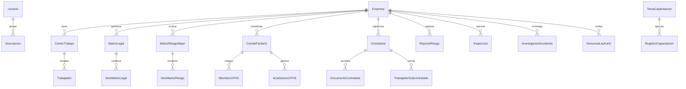

# 🗺️ MAPA MAESTRO DE ARQUITECTURA Y RUTAS — HD PREVENCIÓN

Este documento es la **fuente única de verdad** técnica, funcional y normativa del software SaaS B2B **HD Prevención**. Mapea la totalidad de vistas, rutas URL, modelos de datos, endpoints REST, arquitectura de componentes y marco regulatorio chileno implementado en el monorepositorio.

---

## 1. RESUMEN DEL STACK TECNOLÓGICO Y ARQUITECTURA

- **Frontend:** Next.js 16 (App Router con Turbopack) + React 19 + TypeScript (Strict) + Tailwind CSS v4 (paleta Slate, dark mode nativo, custom scrollbars).
- **Backend:** Django 4.2 LTS + Django REST Framework (DRF) + SimpleJWT + PostgreSQL (producción) / SQLite (desarrollo local).
- **Autenticación y Sesión:** JWT dual (`access_token` y `refresh_token`), soporte de Cookie HttpOnly rotativa y control de acceso basado en roles (`CLIENTE`, `CONSULTORA`, `MODERADOR`, `SUPERADMIN`).
- **Participación en Faena (Códigos QR):** Acceso público sin login para trabajadores en terreno mediante tokens UUID seguros (`/participacion/[uid]/*` y `/capacitaciones/firmar/[uid]`).
- **Firma Electrónica Simple:** Cumplimiento de la Ley N° 19.799 con captura de firma táctil canvas, IP del dispositivo, marca de tiempo ISO 8601 y validación de RUT chileno (Módulo 11).
- **Marco Regulatorio Chileno Vigente (2025/2026):**
  - **Decreto Supremo N° 44 (MINTRAB):** Nuevo reglamento sobre gestión preventiva de riesgos laborales y comités paritarios (deroga expresamente al D.S. 40 y D.S. 54). Regula el Sistema de Gestión SG-SST, Comités Paritarios CPHS (Arts. 23 al 49), Departamentos de Prevención (Art. 50), Delegados SST (Art. 66), Matriz MIPER dinámica (Art. 7), Información de los Riesgos Laborales ODI (Art. 15), Capacitación Preventiva (Art. 16) e Investigación de siniestros (Art. 71).
  - **Ley N° 16.744:** Seguro Social contra Riesgos de Accidentes del Trabajo y Enfermedades Profesionales (Art. 67 RIOHS, Art. 68 Gratuidad y certificación de EPP).
  - **Decreto Supremo N° 594 (MINSAL):** Condiciones Sanitarias y Ambientales Básicas en los Lugares de Trabajo (extintores Arts. 44-52, capacitación EPP Art. 53, radiación UV solar Art. 109).
  - **Ley N° 20.123 y Decreto Supremo N° 76:** Trabajo en régimen de subcontratación, gestión de contratistas y Comités Paritarios de Faena.
  - **Ley Karin (Ley N° 21.643):** Prevención, investigación y sanción del acoso laboral, sexual y violencia en el trabajo; canal de denuncias protegido, medidas cautelares en 72 horas y estricta reserva legal (Art. 211-B Código del Trabajo).
  - **Ley N° 21.719:** Protección de datos personales y sensibles de salud.
  - **Circular N° 3336 SUSESO:** Procedimiento obligatorio ante accidentes graves y fatales (auto-suspensión inmediata de faena, aviso formal Seremi/DT y denuncia DIAT en 24 horas).
  - **Protocolos Oficiales MINSAL/SUSESO:** PREXOR (ruido), TMERT-EESS (ergonomía), Radiación UV, PLANESI (sílice), Plaguicidas y CEAL-SM (riesgos psicosociales).

---

## 2. FRONTEND: MAPA COMPLETO DE RUTAS Y VISTAS (`frontend/src/app/`)

### 2.1. Sección Pública & Comercial (`(public)/` y `components/`)

| Ruta URL | Archivo Principal | Propósito y Contenido |
|---|---|---|
| `/` | `(public)/page.tsx` | **Landing Page Comercial:** Hero de alto impacto, preview interactivo de matriz MIPER, módulos de cumplimiento legal D.S. N° 44, flujo de firma digital sin apps, testimonios y llamadas a la acción. |
| — | `components/Header.tsx` | **Navbar Público:** Navegación ergonómica (`Inicio`, `Formatos y Matrices`, `Actualidad Normativa`, `Planes y Precios`, `Contacto`), selector dark/light mode y botón inteligente de sesión (`Ir a mi Panel` / `Iniciar Sesión`). |
| `/documentos` | `(public)/documentos/page.tsx` | **Catálogo de Formatos (+370):** Plantillas descargables clasificadas por rubro (reglamentos RIOHS, matrices IPER, actas CPHS, inducciones ODI D.S. 44, protocolos MINSAL). |
| `/documentos/editar/[id]` | `(public)/documentos/editar/[id]/page.tsx` | **Editor Web de Documentos:** Edición en vivo de plantillas maestras y exportación personalizada. |
| `/noticias` | `(public)/noticias/page.tsx` | **Centro de Actualidad Normativa:** Feed editorial con buscador y filtros temáticos (D.S. 44, Ley Karin, SUSESO, Radiación UV, CPHS) con artículos técnicos de referencia. |
| `/planes` | `(public)/planes/page.tsx` | **Planes y Precios:** Matriz comparativa de suscripciones (Básico, Profesional, Corporativo) construida sobre `components/PlanesView.tsx`. |
| `/servicios` | `(public)/servicios/page.tsx` | **Catálogo de Asesorías:** Servicios de consultoría experta en SST, auditorías en terreno e implementación de SG-SST. |
| `/capacitaciones` | `(public)/capacitaciones/page.tsx` | **Oferta Pública y Cotizador:** Catálogo de capacitaciones corporativas, inducción ODI (Art. 15 D.S. 44) y cotizador interactivo para empresas. |
| `/contacto` | `(public)/contacto/page.tsx` | **Formulario de Contacto:** Registro de prospectos comerciales y consultas corporativas. |

---

### 2.2. Autenticación y Registro (`(auth)/`)

| Ruta URL | Archivo Principal | Propósito |
|---|---|---|
| `/ingreso` | `(auth)/ingreso/page.tsx` | Inicio de sesión seguro con JWT (`access_token` y `refresh_token`), soporte de arranque en frío para backend en Render y redirección automática según rol. |
| `/registro` | `(auth)/registro/page.tsx` | Registro de nuevos usuarios y empresas clientes con vinculación inicial a plan. |

---

### 2.3. Portal del Dashboard por Roles (`(dashboard)/`)

| Ruta URL | Archivo Principal | Propósito y Control de Acceso |
|---|---|---|
| `/panel` | `(dashboard)/panel/page.tsx` | **Enrutador Inteligente:** Redirige automáticamente al usuario según su rol decodificado del token (`CLIENTE` ➔ `/panel/cliente`, `CONSULTORA` ➔ `/panel/consultora`, `MODERADOR` ➔ `/panel/admin-moderador`, `SUPERADMIN` ➔ `/panel/superadmin`). |
| `/panel/cliente` | `(dashboard)/panel/cliente/page.tsx` | **Dashboard Principal:** KPIs de seguridad, índice de frecuencia, capacitaciones vigentes, inspecciones, estado de matriz legal D.S. N° 44 y accesos directos de faena. |
| `/panel/consultora` | `(dashboard)/panel/consultora/page.tsx` | **Dashboard Multi-Empresa:** Vista especializada para consultoras y prevencionistas que administran múltiples empresas clientes, asientos y centros de trabajo. |
| `/panel/admin-moderador` | `(dashboard)/panel/admin-moderador/page.tsx` | **Panel Moderador:** Supervisión operativa de empresas y validación documental (`is_staff`). |
| `/panel/superadmin` | `(dashboard)/panel/superadmin/page.tsx` | **Panel Superadministrador:** Métricas globales del sistema, gestión total de usuarios, planes y auditorías (`is_superuser`). |
| — | `(dashboard)/layout.tsx` | **Layout Maestro & Sidebar:** Menú lateral ergonómico organizado en 6 bloques normativos, scroll estilizado (`custom-scrollbar`), detección de ruta activa y header superior de sesión. |

---

### 2.4. Módulos Operativos del Dashboard (Los 6 Bloques Ergonómicos)

Organizados según la estructura de [frontend/src/app/(dashboard)/layout.tsx](file:///c:/Users/Ignacio/Documents/Proyectos/Proyecto-hdprevencion/frontend/src/app/(dashboard)/layout.tsx):

#### BLOQUE 1: VISTA GENERAL
- `/panel` ➔ Redirección al panel del rol correspondiente.

#### BLOQUE 2: GESTIÓN & MATRICES (D.S. N° 44)
- `/panel/matriz-legal` (`matriz-legal/page.tsx`): **Matriz Legal Automatizada por Rubro:** Generador de requisitos según actividad económica CIIU, auditoría de brechas normativas y exportación fiscalizable.
  - Subcomponentes: `ModalEditarItem.tsx`, `ModalGenerarMatriz.tsx`, `ModalImprimirMatriz.tsx`, `types.ts`.
- `/panel/matriz-riesgos` (`matriz-riesgos/page.tsx`): **Matriz de Riesgos (MIPER / IPER):** Matriz 5x5 interactiva según Guía ISP, evaluación de riesgo puro, jerarquía legal de controles (Eliminación, Sustitución, Ingeniería, Administrativo, EPP) y riesgo residual.
  - Subcomponentes: `MatrizCalorWidget.tsx`, `ModalCrearMatriz.tsx`, `ModalItemMiper.tsx`, `ModalImprimirMiper.tsx`, `types.ts`.
- `/panel/comite-paritario` (`comite-paritario/page.tsx`): **Comité Paritario de Higiene y Seguridad (CPHS):** Gestión de constitución (>25 trabajadores D.S. 44 Arts. 23 al 49), nómina de miembros, actas mensuales e inspecciones paritarias.
  - Subcomponentes: `EstructuraMiembrosTab.tsx`, `LibroActasTab.tsx`, `ModalConstituirCPHS.tsx`, `ModalCrearActa.tsx`, `ModalImprimirActa.tsx`, `ModalMiembroCPHS.tsx`, `ResumenLegalStats.tsx`, `types.ts`.

#### BLOQUE 3: OPERACIÓN EN FAENA
- `/panel/epp-riohs` (`epp-riohs/page.tsx`): **Entrega de EPP y RIOHS:** Comprobante digital de entrega gratuita de EPP (Art. 68 Ley 16.744) y entrega de Reglamento Interno (Art. 67) con firma simple Ley 19.799.
  - Subcomponentes: `ModalComprobanteImprimible.tsx`, `ModalNuevaEntrega.tsx`, `ModalQRFirmaMovilEPP.tsx`, `SignatureCanvas.tsx`, `types.ts`.
- `/panel/reportes-riesgo` (`reportes-riesgo/page.tsx`): **Reportes QR y Hallazgos:** Gestión de incidentes reportados en terreno con fotos, criticidad y asignación de medidas correctivas.
  - Subcomponentes: `ModalCrearReporte.tsx`, `ModalFotoPreview.tsx`, `ModalInformeVisita.tsx`, `ModalPlantillas.tsx`, `ModalResolverReporte.tsx`, `ReporteItemCard.tsx`, `ReportesFiltrosBar.tsx`, `ReportesHeaderStats.tsx`, `ReportesListado.tsx`, hook `useReportesRiesgo.ts`, `types.ts`.
- `/panel/inspecciones` (`inspecciones/page.tsx`): **Checklists e Inspecciones:** Listas de chequeo normativas en terreno (D.S. 594 extintores, servicios higiénicos, orden y aseo).
- `/panel/capacitaciones` (`capacitaciones/page.tsx`): **Capacitaciones y Charlas:** Control de inducciones ODI (Art. 15 D.S. N° 44), charlas operativas de 5 minutos y registro de asistencia.
  - Subrutas: `/panel/capacitaciones/nueva` y `/panel/capacitaciones/[id]`.
- `/panel/accidentes` (`accidentes/page.tsx`): **Investigación de Accidentes:** Análisis de causas raíz (Árbol de Causas), clasificación Trabajo/Trayecto, generación de informe DIAT y cumplimiento Circular 3336 SUSESO.
  - Subrutas: `/panel/accidentes/nueva` y `/panel/accidentes/[id]`.
- `/panel/contratistas` (`contratistas/page.tsx`): **Contratistas y Subcontratación (Ley 20.123 / D.S. 76):** Control documental de empresas contratistas, trabajadores en faena y cumplimiento de Reglamento Especial.
  - Subruta: `/panel/contratistas/[id]`.

#### BLOQUE 4: CANAL FORMAL
- `/panel/buzon-digital` (`buzon-digital/page.tsx`): **Canal Ley Karin 21.643 y Buzón:** Gestión segura y confidencial de denuncias por acoso laboral, sexual y violencia en el trabajo, con registro de auditoría estricto, medidas de resguardo inmediatas en 72 horas y derivación a la DT / mutualidades.

#### BLOQUE 5: RECURSOS
- `/documentos` ➔ Acceso directo a la biblioteca oficial de más de 370 formatos y descargas legales.

#### BLOQUE 6: CONFIGURACIÓN
- `/panel/servicios` (`servicios/page.tsx`): **Asesorías Premium:** Exclusivo para usuarios con plan activo de pago (`isPaidPlan`).
- `/panel/planes` (`planes/page.tsx`): **Planes de Suscripción:** Estado del plan actual, upgrades y comparativa comercial.
- `/panel/perfil` (`perfil/page.tsx`): **Mi Perfil:** Configuración de cuenta, empresa asociada, RUT y credenciales.
- Enlaces de administración condicionales por rol: `Panel Superadmin`, `Panel Moderador` y `Administrar Asientos`.

---

### 2.5. Portal Móvil de Participación en Terreno (Sin Apps ni Login — Códigos QR)

| Ruta URL | Archivo Principal | Propósito en Faena |
|---|---|---|
| `/participacion/[uid]/reportar` | `participacion/[uid]/reportar/page.tsx` | El trabajador escanea el QR en faena y reporta un acto o condición insegura con evidencia fotográfica y ubicación sin requerir cuenta. |
| `/participacion/[uid]/buzon` | `participacion/[uid]/buzon/page.tsx` | Buzón digital accesible por QR para ingresar denuncias formales Ley Karin (Art. 211-B) con código de seguimiento o sugerencias de prevención. |
| `/capacitaciones/firmar/[uid]`| `capacitaciones/firmar/[uid]/page.tsx` | Registro de firma electrónica simple desde el smartphone del trabajador o modo quiosco en tablet del relator. |

---

### 2.6. Capa de Servicios y Hooks del Frontend

- **`frontend/src/app/utils/api.ts`:**
  - `getApiUrl(path)`: Resuelve dinámicamente la URL base del backend según entorno (`localhost` para desarrollo, `NEXT_PUBLIC_API_URL` para Vercel en producción).
  - `parseJsonResponse<T>(response)`: Parser seguro que intercepta errores de cold-start o spin-down de servidores cloud (Render 502/503/504) evitando fallas de parsing JSON.
  - `refreshAccessToken()`: Manejador de refresh token concurrente con promise singleton y soporte dual (Cookie HttpOnly rotativa y localStorage).
  - `authFetch(url, options)`: Wrapper transparente para peticiones autenticadas con inyección de headers Bearer y reintento automático tras refresh.
- **`frontend/src/app/hooks/useAuth.ts`:**
  - Hook de sesión reactiva con tipado completo (`UserProfile`), validación de estado de autenticación, control de redirección y cierre de sesión.

---

## 3. BACKEND DJANGO: MODELOS Y ARQUITECTURA (`backend/modulo_prevencion/`)

### 3.1. Arquitectura Relacional de Modelos (`models.py`)

### 3.2. Catálogo de Modelos por Dominio Funcional

#### Dominio 1: Usuarios, Planes y Suscripción
- **`Usuario`** (`AbstractUser`): Modelo personalizado con `tipo_usuario` (`CLIENTE`, `CONSULTORA`, `MODERADOR`, `SUPERADMIN`), RUT chileno validado, teléfono, empresa vinculada, foto de perfil y cuenta padre para multi-asientos.
- **`Plan`**: Catálogo de suscripciones (`basico`, `profesional`, `corporativo`), precio mensual, límite de trabajadores y flag `acceso_servicios`.
- **`Suscripcion`**: Registro de suscripción activa por empresa/usuario, periodo de vigencia y estado.
- **`ContadorDescargas`**: Control de descargas de plantillas por usuario y periodo según límites del plan.

#### Dominio 2: Organización y Estructura
- **`Empresa`**: Razón social, RUT, giro económico CIIU, dirección, mutualidad asociada (ACHS, Mutual, IST, ISL) y token UUID público para operaciones QR.
- **`CentroTrabajo`**: Sucursal, obra o faena operativa perteneciente a una empresa.
- **`Trabajador`**: Ficha del personal con RUT, nombre, cargo, fecha de ingreso, centro de trabajo y estado activo.

#### Dominio 3: Matrices y Gestión D.S. N° 44 (2025/2026)
- **`RequisitoLegalBase`**: Base maestra de exigencias normativas chilenas clasificadas por organismo fiscalizador (`DT`, `SEREMI`, `SUSESO`, `SERNAGEOMIN`, `SEC`, `SMA`, `MINTRAB`), tipo de norma, artículo exacto, descripción técnica, sanción/multa y condición de activación por rubro.
- **`MatrizLegal`**: Instancia de matriz legal por empresa y centro de trabajo, porcentaje de cumplimiento y fecha de auditoría.
- **`ItemMatrizLegal`**: Estado de cumplimiento individual (`CUMPLE`, `NO_CUMPLE`, `EN_PROCESO`, `NO_APLICA`), responsable, plazo y archivo de respaldo.
- **`MatrizRiesgoMiper`**: Matriz de Identificación de Peligros y Evaluación de Riesgos bajo Guía Técnica ISP y D.S. N° 44.
- **`ItemMatrizRiesgo`**: Registro de peligro, probabilidad (1-5), consecuencia (1-5), Magnitud de Riesgo Puro, Jerarquía legal de controles de la Guía ISP (Eliminación, Sustitución, Ingeniería, Administrativo, EPP), MR Residual y plan de acción preventivo.

#### Dominio 4: Comités Paritarios (CPHS) y EPP/RIOHS
- **`ComiteParitario`**: Registro de CPHS para centros con más de 25 trabajadores (D.S. N° 44 Arts. 23 al 49), fecha de constitución, periodo de vigencia, número de registro REL DT y alerta de 15 días.
- **`MiembroCPHS`**: Nómina de integrantes titulares y suplentes (empresa y trabajadores), cargo (Presidente, Secretario, Miembro) y registro de cursos de capacitación.
- **`ActaSesionCPHS`**: Actas mensuales de sesiones ordinarias y extraordinarias, acuerdos paritarios, seguimiento de cumplimiento y firmas.
- **`EntregaEPP`**: Comprobante legal de entrega gratuita de EPP (Art. 68 Ley 16.744) y entrega de RIOHS (Art. 67) con firma simple Ley 19.799, IP y marca temporal.

#### Dominio 5: Operación en Faena, Inspecciones y Siniestros
- **`ReporteRiesgo`**: Incidentes y condiciones inseguras reportadas por trabajadores (vía QR o panel), clasificación, fotografía de evidencia, criticidad y resolución.
- **`PlantillaInspeccion`**: Checklists maestros con preguntas estructuradas (D.S. 594, extintores, orden y aseo).
- **`Inspeccion`**: Ejecución de inspección en terreno con porcentaje de conformidad y observaciones.
- **`InvestigacionAccidente`**: Informe técnico de siniestros graves o leves, clasificación Trabajo/Trayecto, análisis por Árbol de Causas, generación de DIAT y protocolo de accidentes graves/fatales (Circular 3336 SUSESO).
- **`TemaCapacitacion`**: Catálogo maestro de inducciones y charlas (Información de riesgos laborales ODI Art. 15 D.S. 44, Charlas de 5 min, Cursos CPHS, Protocolos MINSAL).
- **`RegistroCapacitacion`**: Sesión de capacitación ejecutada con lista de asistentes, firmas digitales, estado y emisión de certificados.
- **`SolicitudCapacitacion`**: Solicitud interna de cotización para capacitaciones corporativas especializadas.

#### Dominio 6: Canal Reservado Ley Karin (Ley N° 21.643)
- **`DenunciaLeyKarin`**: Registro confidencial de denuncias por acoso sexual, laboral o violencia en el trabajo; código único de seguimiento, medidas de resguardo cautelar en 72 horas y derivación formal a la DT / mutualidad.
- **`AuditLogAccesoDenuncia`**: Registro inmutable de cada acceso o visualización del expediente por motivos de estricta confidencialidad legal (Ley 21.643 y Ley 21.719 de Protección de Datos).
- **`SugerenciaLaboral` & `SugerenciaConsulta`**: Canal interno y público para reclamos operativos y sugerencias de mejora en condiciones de trabajo.

#### Dominio 7: Subcontratación (Ley N° 20.123 / D.S. 76)
- **`Contratista`**: Registro de empresas contratistas y subcontratistas acreditadas en faena, RUT, mutualidad y vigencia.
- **`DocumentoContratista`**: Certificados laborales y previsionales F30, F30-1, programas de seguridad y constancias.
- **`TrabajadorSubcontratado`**: Nómina de personal externo autorizado para ingresar a las faenas.

#### Dominio 8: Catálogo y Biblioteca Pública
- **`PlantillaMaestra`**: Catálogo de formatos descargables (.docx, .pdf, .xlsx).
- **`DocumentoUsuario`**: Documentos generados y personalizados por los usuarios.
- **`Noticia`**: Publicaciones del centro de inteligencia regulatoria.
- **`Servicio`**: Catálogo de asesorías técnicas y consultorías especializadas.
- **`MensajeContacto`**: Registro de mensajes enviados desde el formulario de contacto público.

---

### 3.3. Endpoints de la API REST (`urls.py`)

Base de la API: `http://localhost:8000/api/` (o variable `NEXT_PUBLIC_API_URL` en producción).

#### Endpoints de Autenticación y Dashboard
| Endpoint | Vista / Handler | Método | Propósito |
|---|---|---|---|
| `/api/auth/register/` | `RegisterView` | POST | Registro de nuevo usuario y empresa |
| `/api/auth/login/` | `CustomTokenObtainPairView` | POST | Emisión de tokens JWT (`access` y `refresh`) |
| `/api/auth/token/refresh/` | `CustomTokenRefreshView` | POST | Renovación de token JWT mediante refresh token |
| `/api/auth/logout/` | `LogoutView` | POST | Cierre de sesión y revocación de tokens |
| `/api/dashboard/stats/` | `DashboardStatsView` | GET | Estadísticas y KPIs consolidados por rol |

#### Endpoints Públicos de Participación en Terreno (Sin Login vía QR)
| Endpoint | Vista / Handler | Método | Propósito |
|---|---|---|---|
| `/api/publico/<uuid:prevencionista_uuid>/reportar-riesgo/` | `ReporteRiesgoPublicoCreateView` | POST | Reporte de actos o condiciones inseguras |
| `/api/publico/<uuid:prevencionista_uuid>/buzon/` | `SugerenciaConsultaPublicaCreateView` | POST | Ingreso de sugerencias o denuncias anónimas |
| `/api/publico/<uuid:prevencionista_uuid>/empresas/` | `PublicoEmpresasListView` | GET | Listado público de empresas vinculadas al token |

#### ViewSets Principales Registrados en el Router
| Endpoint | ViewSet | Operaciones CRUD y Acciones Especiales |
|---|---|---|
| `/api/plantillas-maestras/` | `PlantillaMaestraViewSet` | GET (Catálogo), `@action preview` |
| `/api/documentos-usuario/` | `DocumentoUsuarioViewSet` | CRUD, `@action descargar_excel`, `@action descargar_docx` |
| `/api/noticias/` | `NoticiaViewSet` | GET / CRUD |
| `/api/contacto/` | `MensajeContactoViewSet` | POST / CRUD |
| `/api/servicios/` | `ServicioViewSet` | GET / CRUD |
| `/api/usuarios/` | `UsuarioViewSet` | CRUD, `@action perfil`, `@action cambiar_plan` |
| `/api/planes/` | `PlanViewSet` | GET / CRUD |
| `/api/reportes-riesgo/` | `ReporteRiesgoViewSet` | CRUD, `@action resolver`, `@action informe_visita` |
| `/api/plantillas-inspeccion/` | `PlantillaInspeccionViewSet` | CRUD |
| `/api/inspecciones/` | `InspeccionViewSet` | CRUD |
| `/api/accidentes/` | `InvestigacionAccidenteViewSet` | CRUD, `@action registrar_diat`, `@action protocolo_grave_fatal` |
| `/api/temas-capacitacion/` | `TemaCapacitacionViewSet` | CRUD |
| `/api/registro-capacitacion/` | `RegistroCapacitacionViewSet` | CRUD, `@action finalizar`, `@action detalles_publicos`, `@action registrar_asistencia` |
| `/api/solicitudes-capacitacion/` | `SolicitudCapacitacionViewSet` | CRUD |
| `/api/buzon/` | `SugerenciaConsultaViewSet` | CRUD, `@action responder` |
| `/api/contratistas/` | `ContratistaViewSet` | CRUD, `@action dashboard` |
| `/api/documentos-contratista/` | `DocumentoContratistaViewSet` | CRUD |
| `/api/trabajadores-subcontratados/`| `TrabajadorSubcontratadoViewSet`| CRUD |
| `/api/empresas/` | `EmpresaViewSet` | CRUD |
| `/api/centros-trabajo/` | `CentroTrabajoViewSet` | CRUD |
| `/api/trabajadores/` | `TrabajadorViewSet` | CRUD |
| `/api/sugerencias-laborales/` | `SugerenciaLaboralViewSet` | CRUD, `@action responder` |
| `/api/denuncias-ley-karin/` | `DenunciaLeyKarinViewSet` | CRUD protegido, `@action registrar_medidas`, `@action derivar_dt`, `@action derivar_mutualidad` |
| `/api/comites-paritarios/` | `ComiteParitarioViewSet` | CRUD, `@action estadisticas` |
| `/api/miembros-cphs/` | `MiembroCPHSViewSet` | CRUD |
| `/api/actas-cphs/` | `ActaSesionCPHSViewSet` | CRUD, `@action cambiar_estado_acuerdo` |
| `/api/entregas-epp/` | `EntregaEPPViewSet` | CRUD, `@action estadisticas` |
| `/api/requisitos-legales-base/`| `RequisitoLegalBaseViewSet` | GET / Listado oficial |
| `/api/matrices-legales/` | `MatrizLegalViewSet` | CRUD, `@action generar_automatica`, `@action estadisticas` |
| `/api/items-matriz-legal/` | `ItemMatrizLegalViewSet` | CRUD |
| `/api/matrices-riesgo-miper/` | `MatrizRiesgoMiperViewSet` | CRUD, `@action matriz_calor`, `@action estadisticas` |
| `/api/items-matriz-riesgo/` | `ItemMatrizRiesgoViewSet` | CRUD |

---

### 3.4. Comandos de Gestión y Pobladores de Datos

1. **`poblar_requisitos_legales` (`backend/modulo_prevencion/management/commands/poblar_requisitos_legales.py`):**
   - Puebla el catálogo maestro de más de 27 requisitos legales chilenos con artículos exactos, sanciones y multas en UTM.
   - Ejecución: `python manage.py poblar_requisitos_legales`.
2. **`seed_conferencias` (`backend/modulo_prevencion/management/commands/seed_conferencias.py`):**
   - Siembra los temas base de inducciones de ingreso (Art. 15 D.S. N° 44) y capacitaciones periódicas con preguntas de evaluación.
   - Ejecución: `python manage.py seed_conferencias`.
3. **`seed.py` (`backend/seed.py`):**
   - Sembrador completo de prueba: planes, usuarios demo por rol, empresas, centros de trabajo y capacitaciones.
   - Ejecución: `python seed.py`.

---

## 4. DIRECTRICES DE CALIDAD Y REGLAS DE DESARROLLO

1. **Vigencia Normativa Estricta (Regla D.S. N° 44):**
   - **NUNCA** citar los Decretos Supremos N° 40 o N° 54 como normas vigentes. Ambos fueron formalmente derogados el 1 de febrero de 2025 por el **Decreto Supremo N° 44**. Toda referencia a SG-SST, CPHS u Obligación de Informar de los riesgos laborales debe citar exclusivamente el **D.S. N° 44** (Art. 15 para información de riesgos y Arts. 23 al 49 para comités paritarios).
2. **Seguridad en Rutas Públicas QR:**
   - Todo acceso público para trabajadores (reportes en terreno, buzón y firmas de charlas) debe utilizar tokens UUID (`prevencionista_uuid` o `token_publico`). **Nunca exponer identificadores numéricos secuenciales** en URLs públicas.
3. **Reserva y Confidencialidad Ley Karin (Art. 211-B):**
   - Las denuncias ingresadas bajo la Ley Karin deben mantener reserva estricta de identidad. Todo acceso a expedientes debe registrarse en `AuditLogAccesoDenuncia`, y los plazos de medidas de resguardo no deben exceder las 72 horas legales.
4. **Resiliencia en Peticiones Backend:**
   - Toda llamada HTTP debe utilizar `parseJsonResponse` y `authFetch` para tolerar arranques en frío de instancias cloud sin romper la interfaz de usuario.
5. **Diseño Frontend y Ergonomía:**
   - Todo componente debe respetar la paleta Slate y acentos `orange-600` / `emerald-500`, con compatibilidad total con modo oscuro (`dark:`).
   - Las páginas `page.tsx` deben priorizar el desacople de lógica compleja en componentes específicos (`_components/` o `components/`) y custom hooks.
