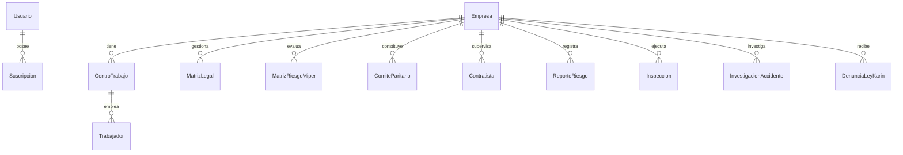

# 🗺️ MAPA MAESTRO DE ARQUITECTURA Y RUTAS — HD PREVENCIÓN

Este documento es la **fuente única de verdad** técnica, funcional y normativa para desarrolladores, auditores y el sistema unificado de agentes de Inteligencia Artificial. Mapea la totalidad de vistas, rutas URL, modelos de datos, endpoints REST, biblioteca regulatoria y subsistemas en el monorepositorio.

---

## 1. RESUMEN DEL STACK TECNOLÓGICO Y ARQUITECTURA

- **Frontend:** Next.js 16 (App Router con Turbopack) + React 19 + TypeScript (Strict) + Tailwind CSS v4 (paleta Slate, dark mode nativo).
- **Backend:** Django 4.2 LTS + Django REST Framework (DRF) + Autenticación JWT (SimpleJWT) + PostgreSQL / SQLite local.
- **Participación en Faena (QR):** Acceso público sin login para trabajadores mediante tokens UUID (`/participacion/[uid]/*` y `/capacitaciones/firmar/[uid]`).
- **Sistema de Agentes IA:** `agentes/orquestador.py` con motor híbrido:
  - **Local:** Ollama (`qwen2.5:7b` / `qwen2.5:14b` / `qwen2.5-coder:7b`) acelerado en GPU NVIDIA RTX 3050 (8GB VRAM).
  - **Nube:** Google Gemini API (`gemini-2.5-flash`).
- **Marco Regulatorio Chileno 2025/2026:** D.S. N° 44 (Nuevo SG-SST y CPHS que deroga D.S. 40 y D.S. 54), Ley 16.744, D.S. 594, Ley Karin 21.643, Ley 20.123 (D.S. 76 Subcontratación), Ley 19.799 (Firma electrónica simple) y Protocolos MINSAL/SUSESO.

---

## 2. FRONTEND: MAPA COMPLETO DE RUTAS Y VISTAS (`frontend/src/app/`)

### 2.1. Sección Pública & Comercial (`(public)/` y `components/`)

| Ruta URL | Archivo Principal | Propósito y Contenido |
|---|---|---|
| `/` | `(public)/page.tsx` | **Landing Page Comercial:** Hero de alto impacto, matriz interactiva preview, módulos de cumplimiento legal D.S. 44, operación QR en terreno sin apps, testimonios y CTA. |
| — | `components/Header.tsx` | **Navbar Público:** Navegación ergonómica (`Inicio`, `Formatos y Matrices`, `Actualidad Normativa`, `Planes y Precios`, `Contacto`), selector dark/light mode y botón inteligente de sesión (`Ir a mi Panel` / `Iniciar Sesión` + `Comenzar Gratis`). |
| `/documentos` | `(public)/documentos/page.tsx` | **Catálogo de Formatos (+370):** Plantillas descargables clasificadas por rubro (reglamentos RIOHS, matrices IPER, actas CPHS, ODI, formatos DT). |
| `/documentos/editar/[id]` | `(public)/documentos/editar/[id]/page.tsx` | **Editor Web de Documentos:** Edición en vivo de plantillas maestras y exportación personalizada. |
| `/noticias` | `(public)/noticias/page.tsx` | **Centro de Inteligencia y Actualidad Normativa:** Feed editorial con buscador, filtros temáticos (D.S. 44, Ley Karin, SUSESO, Radiación UV, CPHS) y catálogo enriquecido de fallbacks oficiales 2026. |
| `/planes` | `(public)/planes/page.tsx` | **Planes y Precios:** Matriz comparativa de suscripciones (Básico, Profesional, Corporativo) y características SaaS. |
| `/servicios` | `(public)/servicios/page.tsx` | **Catálogo de Asesorías Premium:** Servicios de consultoría experta, auditorías en terreno e implementación SG-SST. |
| `/capacitaciones` | `(public)/capacitaciones/page.tsx` | **Oferta Pública de Capacitación:** Cursos de prevención y estándares formativos. |
| `/contacto` | `(public)/contacto/page.tsx` | **Formulario de Contacto:** Registro de prospectos comerciales y consultas corporativas. |

---

### 2.2. Autenticación y Registro (`(auth)/`)

| Ruta URL | Archivo Principal | Propósito |
|---|---|---|
| `/ingreso` | `(auth)/ingreso/page.tsx` | Formulario de inicio de sesión con JWT (`access_token` y `refresh_token`), validación y redirección a `/panel`. |
| `/registro` | `(auth)/registro/page.tsx` | Registro de nuevos usuarios y empresas clientes con vinculación inicial a plan. |

---

### 2.3. Portal del Dashboard por Roles (`(dashboard)/`)

| Ruta URL | Archivo Principal | Propósito y Acceso |
|---|---|---|
| `/panel` | `(dashboard)/panel/page.tsx` | **Enrutador Inteligente:** Redirige automáticamente al usuario según su rol decodificado del JWT (`CLIENTE` ➔ `/panel/cliente`, `CONSULTORA` ➔ `/panel/consultora`, `MODERADOR` ➔ `/panel/admin-moderador`, `SUPERADMIN` ➔ `/panel/superadmin`). |
| `/panel/cliente` | `(dashboard)/panel/cliente/page.tsx` | **Dashboard Principal:** KPIs de seguridad, índice de frecuencia, capacitaciones vigentes, inspecciones realizadas, cumplimiento legal D.S. 44 y accesos rápidos de faena. |
| `/panel/consultora` | `(dashboard)/panel/consultora/page.tsx` | **Dashboard Multi-Empresa:** Para prevencionistas y consultoras que administran múltiples empresas clientes, asientos y faenas. |
| `/panel/admin-moderador`| `(dashboard)/panel/admin-moderador/page.tsx`| **Panel Moderador:** Supervisión operativa de empresas y validación documental (`is_staff`). |
| `/panel/superadmin` | `(dashboard)/panel/superadmin/page.tsx` | **Panel Superadministrador:** Métricas globales del sistema, gestión total de usuarios, planes y auditorías (`is_superuser`). |
| — | `(dashboard)/layout.tsx` | **Layout Maestro & Sidebar:** Menú lateral ergonómico organizado en los 6 bloques normativos del prevencionista, scrollbar estilizado (`custom-scrollbar`), detección de ruta activa y header superior de sesión. |

---

### 2.4. Módulos Operativos del Dashboard (Los 6 Bloques Ergonómicos)

Organizados según la estructura de [frontend/src/app/(dashboard)/layout.tsx](file:///c:/Users/Ignacio/Documents/Proyectos/Proyecto-hdprevencion/frontend/src/app/(dashboard)/layout.tsx):

#### BLOQUE 1: VISTA GENERAL
- `/panel` ➔ Redirección al panel del rol correspondiente.

#### BLOQUE 2: GESTIÓN & MATRICES (D.S. N° 44)
- `/panel/matriz-legal` (`matriz-legal/page.tsx`): **Matriz Legal Automatizada por Rubro:** Generador de requisitos según actividad económica CIIU, auditoría de brechas normativas y exportación DT/Seremi.
- `/panel/matriz-riesgos` (`matriz-riesgos/page.tsx`): **Matriz de Riesgos (MIPER / IPER):** Matriz 5x5 interactiva según Guía ISP, evaluación de riesgo puro, jerarquía legal de controles (Eliminación, Sustitución, Ingeniería, Administrativo, EPP) y riesgo residual.
- `/panel/comite-paritario` (`comite-paritario/page.tsx`): **Comité Paritario de Higiene y Seguridad (CPHS):** Gestión de constitución (>25 trabajadores D.S. 44 Art. 23), nómina de miembros, actas mensuales e inspecciones paritarias.

#### BLOQUE 3: OPERACIÓN EN FAENA
- `/panel/epp-riohs` (`epp-riohs/page.tsx`): **Entrega de EPP y RIOHS:** Comprobante digital de entrega gratuita de EPP (Art. 68 Ley 16.744) y entrega de Reglamento Interno (Art. 67) con firma simple Ley 19.799.
- `/panel/reportes-riesgo` (`reportes-riesgo/page.tsx`): **Reportes QR y Hallazgos:** Gestión de incidentes reportados en terreno con fotos, criticidad y asignación de medidas correctivas.
- `/panel/inspecciones` (`inspecciones/page.tsx`): **Checklists e Inspecciones:** Listas de chequeo normativas en terreno (D.S. 594 extintores, servicios higiénicos, orden y aseo).
- `/panel/capacitaciones` (`capacitaciones/page.tsx`): **Capacitaciones y Charlas:** Control de inducciones ODI (D.S. 44 Art. 21), charlas operativas de 5 minutos y registro de asistencia.
  - Subrutas: `/panel/capacitaciones/nueva` y `/panel/capacitaciones/[id]`.
- `/panel/accidentes` (`accidentes/page.tsx`): **Investigación de Accidentes:** Análisis de causas raíz (Árbol de Causas), clasificación Trabajo/Trayecto, generación de informe DIAT y cumplimiento Circular 3336 SUSESO.
  - Subrutas: `/panel/accidentes/nueva` y `/panel/accidentes/[id]`.
- `/panel/contratistas` (`contratistas/page.tsx`): **Contratistas y Subcontratación (Ley 20.123 / D.S. 76):** Control documental de empresas contratistas, trabajadores en faena y cumplimiento de Reglamento Especial.
  - Subruta: `/panel/contratistas/[id]`.

#### BLOQUE 4: CANAL FORMAL
- `/panel/buzon-digital` (`buzon-digital/page.tsx`): **Canal Ley Karin 21.643 y Buzón:** Gestión segura y confidencial de denuncias por acoso laboral, sexual y violencia en el trabajo, con registro de auditoría estricto y medidas de resguardo inmediatas en 72 horas.

#### BLOQUE 5: RECURSOS
- `/documentos` ➔ Acceso directo a la biblioteca oficial de más de 370 formatos y descargas legales.

#### BLOQUE 6: CONFIGURACIÓN
- `/panel/servicios` (`servicios/page.tsx`): **Asesorías Premium:** Exclusivo para usuarios con plan activo de pago (`isPaidPlan`).
- `/panel/planes` (`planes/page.tsx`): **Planes de Suscripción:** Estado del plan actual, upgrades y pasarela de pago.
- `/panel/perfil` (`perfil/page.tsx`): **Mi Perfil:** Configuración de cuenta, empresa asociada, RUT y credenciales.
- Enlaces de administración condicionales por rol: `Panel Superadmin`, `Panel Moderador` y `Administrar Asientos`.

---

### 2.5. Portal Móvil de Participación en Terreno (Sin Apps ni Login — Códigos QR)

| Ruta URL | Archivo Principal | Propósito en Faena |
|---|---|---|
| `/participacion/[uid]/reportar` | `participacion/[uid]/reportar/page.tsx` | El trabajador escanea el QR en terreno y reporta un acto o condición insegura con foto y ubicación sin necesidad de tener cuenta. |
| `/participacion/[uid]/buzon` | `participacion/[uid]/buzon/page.tsx` | Buzón digital accesible por QR para ingresar denuncias formales Ley Karin (Art. 211-B) o sugerencias de prevención. |
| `/capacitaciones/firmar/[uid]`| `capacitaciones/firmar/[uid]/page.tsx` | Registro de firma electrónica simple desde el celular del trabajador o modo quiosco en la tablet del relator de la charla. |

---

## 3. BACKEND DJANGO: MODELOS Y ARQUITECTURA (`backend/modulo_prevencion/`)

### 3.1. Modelos de Base de Datos (`models.py`)

#### Dominio 1: Usuarios, Planes y Suscripción
- `Plan`: Código de plan (`basico`, `profesional`, `corporativo`), precio, límite de trabajadores, acceso a servicios exclusivos.
- `Usuario`: Modelo personalizado (`AbstractUser`) con `tipo_usuario` (`CLIENTE`, `CONSULTORA`, `MODERADOR`, `SUPERADMIN`), RUT, teléfono, empresa vinculada y foto de perfil.
- `Suscripcion`: Estado de suscripción, fecha inicio/fin, renovación automática y comprobante.

#### Dominio 2: Estructura Organizacional
- `Empresa`: Razón social, RUT de la empresa, giro/rubro económico CIIU, dirección, mutualidad asociada (ACHS, Mutual, IST, ISL), token público QR.
- `CentroTrabajo`: Sucursal, obra o faena operativa asociada a una empresa.
- `Trabajador`: Ficha del trabajador con RUT, nombre, cargo, fecha de ingreso, centro de trabajo y estado activo.

#### Dominio 3: Matrices y Gestión D.S. N° 44 (2025/2026)
- `RequisitoLegalBase`: Base transversal de normativas chilenas con organismo emisor (`DT`, `SEREMI`, `SUSESO`, `SERNAGEOMIN`, `SEC`, `SMA`, `MINTRAB`), tipo de norma, artículo, exigencia legal, sanción/multa y condición de activación.
- `MatrizLegal`: Instancia de matriz legal por empresa y centro de trabajo, porcentaje de cumplimiento y fecha de auditoría.
- `ItemMatrizLegal`: Evaluación de cada requisito (`CUMPLE`, `NO_CUMPLE`, `EN_PROCESO`, `NO_APLICA`), responsable, plazo y archivo de evidencia.
- `MatrizRiesgoMiper`: Identificación de peligros y evaluación de riesgos bajo metodología Guía Técnica ISP y D.S. 44.
- `ItemMatrizRiesgo`: Peligro identificado, probabilidad (1-5), consecuencia (1-5), MR Puro, Jerarquía legal de controles de la Guía ISP (Eliminación, Sustitución, Ingeniería, Administrativo, EPP), MR Residual y plan de acción preventivo.

#### Dominio 4: Comités Paritarios (CPHS) y EPP
- `ComiteParitario`: Registro de CPHS para centros con más de 25 trabajadores (Art. 23 D.S. 44), fecha de constitución, periodo de vigencia y número de registro REL DT.
- `MiembroCPHS`: Integrantes titulares y suplentes representantes de la empresa y de los trabajadores, rol (Presidente, Secretario).
- `ActaSesionCPHS`: Registro de sesiones ordinarias y extraordinarias mensuales, acuerdos y firmas.
- `EntregaEPP`: Constancia legal de entrega gratuita de EPP (Art. 68 Ley 16.744) y entrega de RIOHS (Art. 67) con firma simple Ley 19.799, IP y marca temporal.

#### Dominio 5: Operación en Faena, Inspecciones y Siniestros
- `ReporteRiesgo`: Reportes de terreno originados por QR o panel, tipo de riesgo, foto de evidencia, criticidad y resolución.
- `PlantillaInspeccion`: Checklist maestro estructurado con preguntas de verificación (D.S. 594, extintores, botiquines, etc.).
- `Inspeccion`: Ejecución de inspección en un centro de trabajo con porcentaje de cumplimiento y observaciones.
- `InvestigacionAccidente`: Informe técnico de siniestros graves o leves, clasificación (Trabajo, Trayecto, Enfermedad), metodología Árbol de Causas, medidas inmediatas y cumplimiento Circular 3336 SUSESO.
- `TemaCapacitacion` & `RegistroCapacitacion`: Control de inducción general de riesgos ODI (D.S. 44 Art. 21), charlas de 5 minutos y registro de firmas.
- `SolicitudCapacitacion`: Solicitudes internas de inducciones requeridas por faena.

#### Dominio 6: Canal Formal Ley Karin (Ley N° 21.643)
- `DenunciaLeyKarin`: Registro formal y confidencial de denuncias de acoso sexual, acoso laboral o violencia en el trabajo. Código único de seguimiento, medidas de resguardo inmediatas y derivación formal a la DT.
- `AuditLogAccesoDenuncia`: Registro inmutable de cada acceso o visualización del expediente por motivos de estricta confidencialidad legal (Ley 21.643 y Ley 21.719 de Protección de Datos).
- `SugerenciaLaboral` & `SugerenciaConsulta`: Canal paralelo para reclamos operativos y sugerencias de mejora en condiciones de trabajo.

#### Dominio 7: Subcontratación (Ley N° 20.123 / D.S. 76)
- `Contratista`: Empresa contratista o subcontratista acreditada en faena, RUT, mutualidad y vigencia.
- `DocumentoContratista`: Certificados F30, F30-1, programas de seguridad y pólizas.
- `TrabajadorSubcontratado`: Registro de personal de contratistas que ingresa a obras o faenas.

#### Dominio 8: Catálogo y Biblioteca Pública
- `PlantillaMaestra`: Catálogo de más de 370 documentos descargables (.docx, .pdf, .xlsx).
- `DocumentoUsuario`: Documentos personalizados guardados por las empresas.
- `ContadorDescargas`: Métricas de descargas por usuario y plan.
- `Noticia`, `Servicio`, `MensajeContacto`: Publicaciones informativas y prospección.

---

### 3.2. Endpoints de la API REST (`urls.py`)

Base de la API: `http://localhost:8000/api/`

| Endpoint | ViewSet / Vista | Operaciones |
|---|---|---|
| `/api/auth/register/` | `RegisterView` | POST (Registro de usuario) |
| `/api/auth/login/` | `CustomTokenObtainPairView` | POST (Obtención de tokens JWT) |
| `/api/auth/token/refresh/` | `CustomTokenRefreshView` | POST (Renovación de token JWT) |
| `/api/auth/logout/` | `LogoutView` | POST (Cierre de sesión seguro) |
| `/api/dashboard/stats/` | `DashboardStatsView` | GET (KPIs y estadísticas agregadas) |
| `/api/matrices-legales/` | `MatrizLegalViewSet` | CRUD (Matrices legales por empresa) |
| `/api/items-matriz-legal/` | `ItemMatrizLegalViewSet` | CRUD (Evaluación de requisitos de la matriz) |
| `/api/requisitos-legales-base/` | `RequisitoLegalBaseViewSet` | GET / CRUD (Catálogo oficial de normas SST) |
| `/api/matrices-riesgo-miper/` | `MatrizRiesgoMiperViewSet` | CRUD (Matrices MIPER D.S. 44) |
| `/api/items-matriz-riesgo/` | `ItemMatrizRiesgoViewSet` | CRUD (Peligros y controles ISP) |
| `/api/comites-paritarios/` | `ComiteParitarioViewSet` | CRUD (Gestión CPHS D.S. 44) |
| `/api/miembros-cphs/` | `MiembroCPHSViewSet` | CRUD (Miembros de comités paritarios) |
| `/api/actas-cphs/` | `ActaSesionCPHSViewSet` | CRUD (Actas mensuales del CPHS) |
| `/api/entregas-epp/` | `EntregaEPPViewSet` | CRUD (Comprobantes de EPP y RIOHS) |
| `/api/reportes-riesgo/` | `ReporteRiesgoViewSet` | CRUD (Reportes de actos/condiciones) |
| `/api/inspecciones/` | `InspeccionViewSet` | CRUD (Inspecciones con checklist) |
| `/api/plantillas-inspeccion/` | `PlantillaInspeccionViewSet` | CRUD (Modelos de checklists) |
| `/api/accidentes/` | `InvestigacionAccidenteViewSet` | CRUD (Investigación y DIAT) |
| `/api/temas-capacitacion/` | `TemaCapacitacionViewSet` | CRUD (Catálogo de inducciones/charlas) |
| `/api/registro-capacitacion/` | `RegistroCapacitacionViewSet` | CRUD (Asistencia y firmas de charlas) |
| `/api/denuncias-ley-karin/` | `DenunciaLeyKarinViewSet` | CRUD seguro (Canal confidencial Ley Karin) |
| `/api/sugerencias-laborales/` | `SugerenciaLaboralViewSet` | CRUD (Buzón de sugerencias) |
| `/api/contratistas/` | `ContratistaViewSet` | CRUD (Acreditación Ley 20.123) |
| `/api/documentos-contratista/`| `DocumentoContratistaViewSet` | CRUD (Certificados F30/F30-1) |
| `/api/trabajadores-subcontratados/`| `TrabajadorSubcontratadoViewSet`| CRUD (Trabajadores externos en faena) |
| `/api/empresas/` | `EmpresaViewSet` | CRUD (Empresas administradas) |
| `/api/centros-trabajo/` | `CentroTrabajoViewSet` | CRUD (Sucursales y faenas) |
| `/api/trabajadores/` | `TrabajadorViewSet` | CRUD (Nómina de personal) |
| `/api/plantillas-maestras/` | `PlantillaMaestraViewSet` | GET (Catálogo de plantillas para descarga) |
| `/api/noticias/` | `NoticiaViewSet` | GET / CRUD (Noticias y cambios legales) |
| `/api/publico/<uuid>/reportar-riesgo/` | `ReporteRiesgoPublicoCreateView` | POST público (Sin login vía QR) |
| `/api/publico/<uuid>/buzon/` | `SugerenciaConsultaPublicaCreateView` | POST público (Sin login vía QR) |

---

### 3.3. Poblador de Datos Normativos (`seeder_requisitos.py`)
Script oficial que inserta más de 30 requisitos legales base con artículos exactos, sanciones y multas:
- **Ejecución:** `python backend/manage.py shell < backend/modulo_prevencion/seeder_requisitos.py`

---

## 4. SUBSISTEMA DE AGENTES DE INTELIGENCIA ARTIFICIAL (`agentes/`)

### 4.1. Orquestador Unificado (`agentes/orquestador.py`)

Centraliza la interacción con los 4 Agentes Especializados mediante un menú interactivo y herramientas autónomas (*Function Calling*):

| Agente Especializado | Perfil y Especialidad Técnica | Modelo Local por Defecto |
|---|---|---|
| 👷 **Prevencionista de Riesgos** | Experto legal en SST de Chile (Ley 16.744, D.S. 44, D.S. 594, Ley Karin, Guía ISP, fiscalizaciones Seremi/DT). | `qwen2.5:7b` / `qwen2.5:14b` |
| 🗄️ **Base de Datos & ORM** | Experto en PostgreSQL, Django ORM, migraciones, índices y diseño relacional con prefijos `hdp_`. | `qwen2.5-coder:7b` |
| ⚙️ **Backend Developer** | Desarrollador senior Django REST Framework, serializers, viewsets, servicios y seguridad JWT. | `qwen2.5-coder:7b` |
| 💻 **Frontend Developer** | Ingeniero líder Next.js 16 App Router, React 19, TypeScript y Tailwind CSS v4 con dark mode nativo. | `qwen2.5-coder:7b` |

### 4.2. Herramientas Autónomas Disponibles para los Agentes
1. `consultar_mapa_proyecto()`: Lee este archivo (`MAPA_PROYECTO.md`) para ubicarse en la arquitectura general.
2. `listar_archivos(ruta)`: Explora directorios del proyecto.
3. `leer_archivo(ruta)`: Lee el código fuente de cualquier archivo del monorepositorio.
4. `buscar_en_normativa(termino)`: Búsqueda semántica y por palabras clave en los textos de leyes chilenas en `doc_agents/`.
5. `leer_documento_normativo(nombre)`: Carga el texto íntegro de cualquier decreto o ley.
6. `listar_documentos_normativos()`: Lista todos los documentos legales cargados en el sistema.

### 4.3. Comandos Útiles en la Consola del Agente
- `/pegar` o `/clip`: Lee instantáneamente el texto copiado en el portapapeles de Windows (ideal para prompts de 50+ líneas).
- `/archivo [ruta]`: Carga automáticamente el contenido de un archivo `.txt` o `.md` (por defecto `agentes/prompt.txt`).
- `/modelo`: Cambia el modelo de Ollama en caliente (`qwen2.5:7b` para velocidad vs `qwen2.5:14b` para razonamiento profundo).
- `/motor`: Alterna entre motor local Ollama y motor en la nube Gemini.
- `/limpiar`: Reinicia el contexto de la conversación con el agente actual.
- `menu` o `salir`: Regresa al menú principal.

### 4.4. Biblioteca Legislativa Oficial (`agentes/doc_agents/`)
Contiene los textos íntegros y oficiales de la legislación chilena:
1. `Decreto-44.md`: Decreto Supremo N° 44 (2025/2026) — Nuevo SG-SST, CPHS, ODI, Investigación de siniestros.
2. `Decreto_54.md`: D.S. 54 histórico de 1969 — **Expresamente derogado por el D.S. 44**.
3. `Decreto_76.md`: D.S. 76 — Subcontratación y Comités Paritarios de Faena (Art. 66 bis Ley 16.744).
4. `Decreto_Supremo_N°_594.md`: D.S. 594 — Condiciones sanitarias y ambientales básicas en lugares de trabajo.
5. `Ley-16744.md`: Ley N° 16.744 — Seguro social de accidentes del trabajo y enfermedades profesionales.
6. `Ley-Karin-21643.md` / `Ley-21643.md`: Ley N° 21.643 — Prevención, investigación y sanción del acoso y violencia laboral.
7. `LEY-19799.md`: Ley N° 19.799 — Documentos electrónicos, firma electrónica y certificación digital.
8. `Ley-21719.md`: Ley N° 21.719 — Protección de datos personales y sensibles de salud.
9. `dictamen_dt_362_19_2024_ley_karin.txt`: Dictamen vinculante de la Dirección del Trabajo sobre la Ley Karin.
10. `directriz_dt_decreto_14_2023_registro_electronico_laboral.txt`: Normativa REL de la Dirección del Trabajo.
11. `directriz_suseso_circular_3336_accidentes_graves_fatales.md`: Procedimiento ante accidentes graves y fatales.
12. `guia_dt_registro_comite_paritario_cphs_rel.md`: Guía para inscripción de CPHS en el portal de la DT.
13. `protocolo_minsal_radiacion_uv.md`: Protocolo de exposición a radiación ultravioleta de origen solar.
14. `protocolo_minsal_tmert_eess.md`: Trastornos musculoesqueléticos de extremidades superiores.
15. `protocolo_minsal_prexor_ruido.md`: Exposición ocupacional a ruido.
16. `protocolo_minsal_silice_planesi.md`: Plan nacional de erradicación de la silicosis.
17. `protocolo_minsal_plaguicidas.md`: Vigilancia de trabajadores expuestos a plaguicidas.
18. `protocolo_suseso_ceal_sm_psicosocial.md`: Cuestionario CEAL-SM para evaluación de riesgos psicosociales.

---

## 5. DIRECTRICES DE CALIDAD Y REGLAS DE DESARROLLO

1. **Vigencia Normativa Estricta (Regla D.S. 44):**
   - **NUNCA** citar los Decretos Supremos N° 40 o N° 54 como normas vigentes. Ambos fueron formalmente derogados el 1 de febrero de 2025 por el **Decreto Supremo N° 44**. Toda referencia a SG-SST, CPHS u Obligación de Informar (ODI) debe referenciar exclusivamente el **D.S. N° 44**.
2. **Seguridad en Rutas Públicas QR:**
   - Todo acceso público para trabajadores (reportes en terreno, buzón y firmas de charlas) debe utilizar tokens UUID (`prevencionista_uuid` o `token_publico`). **Nunca exponer identificadores numéricos secuenciales** en URLs públicas.
3. **Manejo de Métricas y Datos Reales:**
   - Nunca hardcodear métricas ni estadísticas en los dashboards. Si una métrica no está disponible en la base de datos, se debe desplegar `"Próximamente / en integración"` o `0`.
4. **Diseño Frontend y Ergonomía:**
   - Todo componente debe respetar la paleta Slate y acentos `orange-600` / `emerald-500`, con compatibilidad total con modo oscuro (`dark:`).
   - Las páginas `page.tsx` no deben exceder las ~300 líneas; la lógica de negocio y estado debe desacoplarse en subcomponentes (`_components/`) y custom hooks (`useAuth`, etc.).
