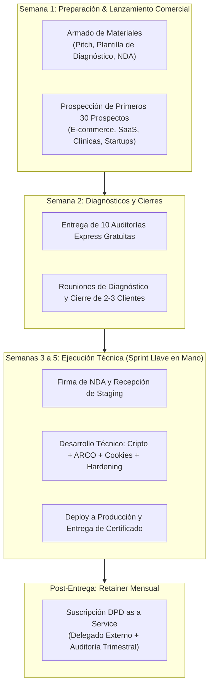
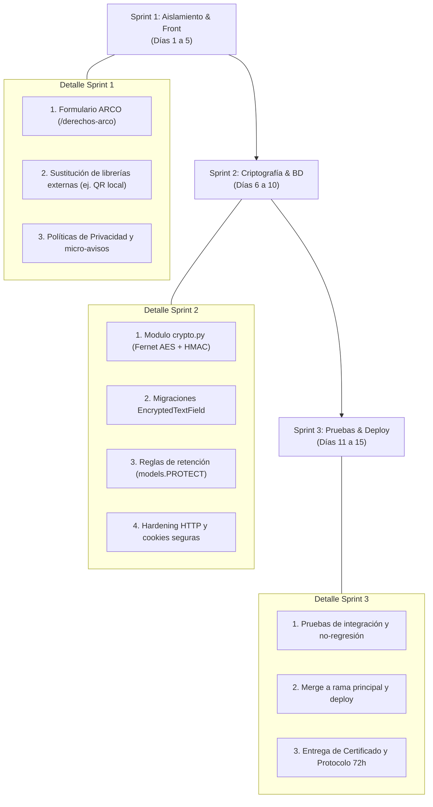

# Plan de Acción Comercial y Operativo: Servicio de Adecuación Técnica Ley N° 21.719
**Iniciativa:** Consultoría Técnica y Blindaje de Software para Cumplimiento de Protección de Datos Personales  
**Equipo Fundador:** Dupla Técnica / Comercial (2 Socios)  
**Horizonte de Lanzamiento:** Inmediato (Noviembre 2026 - Entrada en vigencia Ley 21.719)  
**Moneda / Mercado:** Chile (UF / CLP)  

---

## 1. Definición de Roles del Equipo (Dupla de Trabajo)

Para operar de forma ágil y coordinada, la división de responsabilidades se establece de la siguiente manera:

| Rol | Responsable Sugerido | Responsabilidades Clave |
| :--- | :--- | :--- |
| **Socio 1: Lead Técnico & Criptografía (CTO)** | Socio Desarrollador Principal | • Auditoría profunda de repositorios de clientes (Git/Django/Node/Laravel/React).<br>• Implementación de cifrado en reposo (AES/Fernet) y migraciones de BD.<br>• Integración de endpoints ARCO-POL, scripts de saneamiento y hardening HTTP.<br>• Pruebas de seguridad, despliegue en staging y pase a producción. |
| **Socio 2: Lead Comercial & Gobernanza (CPO / Legal-Tech)** | Socio Operativo / Comercial | • Prospección activa de clientes (LinkedIn, llamadas, WhatsApp, redes de contacto).<br>• Ejecución del "Escaneo Express Gratuito de 24 hrs" (análisis no invasivo externo).<br>• Conducción de reuniones de diagnóstico y presentación de presupuestos.<br>• Redacción y adaptación del Kit Documental (Políticas, Términos, Protocolo de Brechas de 72 hrs, Registro de Actividades). |

---

## 2. Cronograma Maestro de Lanzamiento y Ejecución



---

## 3. Fase 1: Prospección Comercial y Generación de Leads (Días 1 a 7)

### 3.1. Perfil del Cliente Ideal (ICP - Ideal Customer Profile)
Empresas en Chile que **no pueden darse el lujo de recibir una multa de la nueva Agencia**:
1. **Empresas de Software y Plataformas SaaS:** Gestionan datos de múltiples empresas clientes (riesgo crítico de filtración multi-tenant).
2. **Empresas con Datos Sensibles de Empleados:** Plataformas de Prevención de Riesgos, RRHH, control de asistencia, denuncias Ley Karin o telemedicina.
3. **E-commerce y Portales Transaccionales:** Guardan bases de datos de clientes, historiales de compra y carritos.
4. **Clínicas, Centros Médicos y Laboratorios:** Manejan fichas clínicas y datos de salud bajo estándares estrictos.

### 3.2. Estrategia de Contacto: El "Gancho" del Escaneo Express Gratuito (24 Horas)
No se vende una consultoría costosa de inmediato. Se ofrece valor antes de pedir dinero mediante una **Auditoría Técnica de Superficie sin costo**:

#### Mensaje Tipo para Prospección (LinkedIn / WhatsApp / Email Directo)
```text
Asunto: Adecuación técnica obligatoria Ley N° 21.719 en [Nombre de la Empresa]

Hola [Nombre del CEO / CTO / Gerente de Operaciones],

Te escribo porque este próximo mes entra en vigencia en Chile la nueva Ley de Protección de Datos Personales (Ley N° 21.719), que crea la Agencia de Protección de Datos y multas de hasta 20.000 UTM.

Notamos que hoy la gran mayoría de las empresas tienen sus términos desactualizados o carecen de los canales técnicos que la ley exige (como el portal público de Derechos ARCO, cifrado de campos sensibles y protocolos de notificación de brechas en 72 horas).

Con mi equipo estamos realizando una Auditoría Técnica Express de 24 hrs (100% gratuita y sin compromiso) para evaluar la superficie web de [Nombre de la Empresa] y entregarte un reporte semáforo con los puntos críticos que deben corregirse antes de la entrada en vigor.

¿Te interesaría que te enviemos este reporte preliminar mañana?

Saludos cordiales,
[Tu Nombre] - [Teléfono / LinkedIn]
```

---

## 4. Fase 2: Diagnóstico, Demostración y Cierre Comercial (Días 8 a 14)

### 4.1. Cómo realizar la "Auditoría Express Gratuita" (En 30 minutos sin tocar código)
Antes de la reunión, el Socio 2 realiza una inspección externa del sitio del prospecto:
1. **Cabeceras HTTP y SSL:** Escanear la URL en herramientas públicas (ej. *securityheaders.com* o DevTools). Comprobar si faltan `Strict-Transport-Security`, `X-Content-Type-Options` o `Content-Security-Policy`.
2. **Cookies y Rastreadores:** Abrir la consola del navegador (`F12 -> Application -> Cookies`) y verificar si sus cookies de sesión tienen los flags `Secure` y `HttpOnly`, o si rastrean sin consentimiento previo.
3. **Formularios de Contacto o Registro:** Verificar si tienen micro-avisos informativos de consentimiento o si envían contraseñas/datos por canales inseguros.
4. **Términos y Políticas de Privacidad:** Buscar si sus políticas mencionan la antigua Ley 19.628 o si no tienen canal formal para ejercer derechos ARCO-POL.

### 4.2. Estructura de la Reunión de Diagnóstico (30 Minutos)
* **Minuto 0 a 5:** Presentación breve. Explicar el contexto: la ley entra en vigor de inmediato y las multas alcanzan hasta 20.000 UTM o el 4% de la facturación anual.
* **Minuto 5 a 15 (Mostrar el Dolor):** Presentar el reporte express del cliente con semáforo Rojo/Amarillo:
  * *"Tu formulario de registro captura datos personales sin consentimiento explícito."*
  * *"Tus usuarios no tienen un portal para solicitar la portabilidad o eliminación de sus datos."*
  * *"No existe evidencia de que la base de datos cuente con cifrado en reposo para datos confidenciales."*
* **Minuto 15 a 22 (Presentar la Solución Llave en Mano):**
  * *"Un abogado tradicional te cobrará por redactar un PDF y te dejará solo con el problema técnico."*
  * *"Nosotros entramos a tu repositorio, modificamos el código, ciframos la base de datos, implementamos el portal web y te dejamos 100% cubierto en 2 semanas."*
* **Minuto 22 a 30 (Presentación de Paquetes y Cierre):** Entregar propuesta comercial cerrada.

### 4.3. Tabla de Precios y Paquetes de Venta Sugeridos (Mercado Chileno)

| Plan | Destinado a | Alcance del Servicio | Plazo de Ejecución | Rango de Precio Sugerido |
| :--- | :--- | :--- | :--- | :--- |
| **PLAN BASIC** | Sitios Web Corporativos, Landing Pages, E-commerce pequeños | • Auditoría de superficie.<br>• Políticas y Términos adaptados a Ley 21.719.<br>• Banner de cookies interactivo con bloqueo previo.<br>• Formulario público de Derechos ARCO.<br>• Hardening de cabeceras HTTP en servidor web. | 5 a 7 días hábiles | **25 a 45 UF**<br>(~$950.000 - $1.700.000 CLP) |
| **PLAN PRO**<br>*(Más Vendido)* | Aplicaciones Web, Sistemas SaaS, Portales de Clientes / ERP | • Todo lo de Basic +<br>• Cifrado a nivel de campo (AES-128/256 + HMAC) en base de datos.<br>• Prevención de fugas multi-tenant en APIs y serializadores.<br>• Portal de Derechos ARCO con API y exportación JSON (Portabilidad Art. 9).<br>• Protocolo formal de Brechas de Seguridad (72 horas) con registro en BD.<br>• Sanitización de cookies, `localStorage` y Service Workers en logout. | 2 a 3 semanas | **60 a 110 UF**<br>(~$2.300.000 - $4.200.000 CLP) |
| **PLAN ENTERPRISE** | Plataformas con Datos Sensibles (Salud, Prevención de Riesgos, Ley Karin, Fintech) | • Todo lo de Pro +<br>• Cifrado criptográfico reforzado en reposo y tránsito.<br>• Reglas de retención legal obligatoria (`models.PROTECT` vs supresión - SUSESO / DT).<br>• Evaluación de Impacto en Protección de Datos (EIPD formal).<br>• Acompañamiento y soporte técnico directo ante la Agencia. | 3 a 5 semanas | **120 a 220 UF**<br>(~$4.500.000 - $8.400.000 CLP) |

---

## 5. Fase 3: Protocolo de Onboarding y Seguridad Técnica (Día 1 del Proyecto)

Para proteger al cliente y a nosotros mismos, no se escribe una línea de código sin antes completar este checklist:

```
[ ] 1. Firma de NDA Reforzado: Garantiza estricta confidencialidad de bases de datos y propiedad intelectual.
[ ] 2. Acceso a Repositorio: Creación de rama de trabajo exclusiva: git checkout -b feature/ley-21719-compliance
[ ] 3. Entorno de Staging: Acceso a un servidor de pruebas idéntico a producción con base de datos anonimizada.
[ ] 4. Checkpoint de Secretos: Confirmar que el cliente tenga respaldo completo de su base de datos antes de iniciar.
[ ] 5. Levantamiento Inicial (15 min): Identificación de tablas y columnas que contienen nombres, RUT, emails, datos médicos, bancarios o laborales.
```

---

## 6. Fase 4: Metodología de Ejecución Técnica Paso a Paso (Sprints)

Basado en la ingeniería validada en nuestro propio repositorio:



### Checklist Técnico de Verificación Final:
1. `[Backend]` Todas las contraseñas y claves de API retiradas de `settings` o código fuente.
2. `[Backend]` Claves foráneas críticas protegidas contra eliminación accidental (`PROTECT`).
3. `[Backend]` Campos de salud o denuncias cifrados con formato seguro autenticado (`enc:v1:...`).
4. `[Frontend]` Cookies de sesión configuradas con `HttpOnly; Secure; SameSite=Lax/Strict`.
5. `[Frontend]` Cabeceras `HSTS`, `X-Content-Type-Options: nosniff` y `X-Frame-Options: SAMEORIGIN` activas.
6. `[Compliance]` Formulario de Derechos ARCO público y funcional con tracking de ticket.
7. `[Compliance]` Endpoint de portabilidad de datos generando JSON estructurado.

---

## 7. Fase 5: Cierre, Certificación y Modelo de Ingreso Recurrente (Post-Venta)

### 7.1. Entregables Finales al Cliente
1. **Pull Request Aprobado y Desplegado en Producción:** Código documentado y limpio.
2. **Certificado de Normalización y Blindaje Técnico:** Documento PDF firmado por los fundadores detallando todas las medidas técnicas y criptográficas implementadas conforme a la Ley N° 21.719.
3. **Manual de Procedimiento de Brechas de Seguridad (SOP):** Flujograma para que su equipo sepa qué hacer en las primeras 72 horas si sufren un ciberataque.
4. **Registro de Actividades de Tratamiento (RAT):** Inventario formal listo para ser exhibido ante un requerimiento de la Agencia.

### 7.2. Conversión a Ingreso Mensual Recurrente (Retainer / MRR)
Al entregar el proyecto, el cliente se da cuenta de que la ley exige **mantener el cumplimiento en el tiempo**. Se le ofrece el plan de acompañamiento continuo:

| Plan Recurrente | Servicios Incluidos | Tarifa Mensual Sugerida |
| :--- | :--- | :--- |
| **DPD as a Service (Básico)** | • Delegado de Protección de Datos externo designado ante la Agencia.<br>• Canal formal de respuesta a solicitudes ARCO de sus usuarios.<br>• Soporte de 4 horas mensuales ante incidentes. | **8 a 15 UF / mes**<br>(~$300.000 - $570.000 CLP/mes) |
| **DPD + Seguridad Continua (Avanzado)** | • Todo lo anterior +<br>• Auditoría trimestral de código y nuevos deploys.<br>• Revisión de contratos con nuevos proveedores de software (encargados de tratamiento).<br>• Simulacro anual de brecha de seguridad. | **20 a 35 UF / mes**<br>(~$760.000 - $1.330.000 CLP/mes) |

---

## 8. Metas Comerciales para los Primeros 60 Días

* **Objetivo de Prospección:** Contactar a 60 empresas (15 por semana).
* **Conversión Estimada:**
  * 20 Auditorías Express realizadas (33% de respuesta).
  * 6 a 8 Reuniones de diagnóstico.
  * **3 a 4 Proyectos cerrados en el primer mes y medio.**
* **Proyección Financiera Inicial (Primeros 2 meses):**
  * 3 Proyectos Plan PRO promedio (~80 UF c/u) = **240 UF (~$9.100.000 CLP)**.
  * 2 Clientes convertidos a Retainer mensual (~12 UF c/u) = **24 UF/mes (~$910.000 CLP/mes recurrentes)**.
