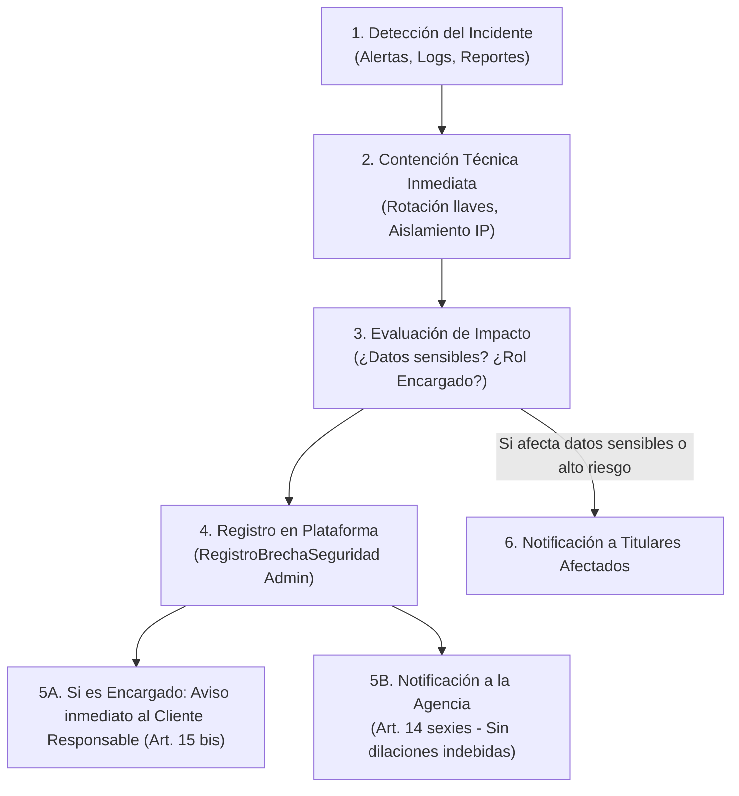

# Procedimiento Operativo Estándar (SOP-SEC-01)
## Gestión y Notificación de Brechas de Seguridad de Datos Personales
**Referencia Normativa:** Ley N° 21.719, Artículos 14 sexies y 15 bis  
**Entidad Responsable:** HD Prevención *(sociedad en formalización; actualizar razón social definitiva al cierre de escritura)*  
**Versión:** 1.1 · **Actualización:** Noviembre 2026  

---

### 1. Objetivo, Alcance y Criterio Legal de Oportunidad
Establecer el protocolo formal para la detección, contención, evaluación, registro y notificación oportuna de incidentes de seguridad que afecten la confidencialidad, integridad o disponibilidad de datos personales tratados en la plataforma HD Prevención, dando cumplimiento estricto a los **Artículos 14 sexies y 15 bis de la Ley N° 21.719**.

> **Nota normativa clave (Ley N° 21.719 vs. GDPR):** El Art. 14 sexies de la Ley N° 21.719 exige reportar por los medios más expeditos posibles y **"sin dilaciones indebidas"** (sin fijar un plazo rígido de 72 horas propio del GDPR europeo). En incidentes de severidad Alta o Crítica, el equipo debe activar notificación inmediata tan pronto exista certeza razonable del incidente. Adicionalmente, cuando HD Prevención actúe como **Encargado del tratamiento** (datos de trabajadores, EPP, accidentes o Ley Karin de clientes), debe avisar **sin dilaciones indebidas a la empresa cliente Responsable** para coordinar las comunicaciones legales.

---

### 2. Definición de Brecha de Seguridad
Cualquier incidente que ocasione de forma accidental o ilícita la destrucción, pérdida, alteración, divulgación no autorizada de datos personales transmitidos, conservados o tratados de otra forma, o el acceso no autorizado a dichos datos.

---

### 3. Matriz de Clasificación de Severidad

| Nivel de Severidad | Criterio de Calificación | Meta Técnica de Contención | Notificación Agencia (Art. 14 sexies) | Notificación Titulares / Cliente Responsable |
| :--- | :--- | :--- | :--- | :--- |
| **Baja** | No compromete datos sensibles ni genera exposición probable a los titulares | < 12 horas | Registro interno obligatorio en `RegistroBrechaSeguridad` | No requerida (evaluar aviso preventivo al cliente si aplica) |
| **Media** | Compromete datos identificatorios básicos sin datos sensibles | < 6 horas | Sin dilaciones indebidas si existe riesgo relevante | Evaluada según riesgo + aviso al cliente si es Encargado |
| **Alta** | Compromete relatos/expedientes Ley Karin, salud laboral, diagnósticos o licencias médicas | < 2 horas | **Obligatoria y sin dilaciones indebidas** | **Obligatoria** a titulares + **inmediata al cliente Responsable** |
| **Crítica** | Exfiltración masiva, compromiso de llave maestra o acceso administrativo no autorizado | Inmediata | **Obligatoria y sin dilaciones indebidas** | **Obligatoria y masiva** + **inmediata al cliente Responsable** |

---

### 4. Flujo Operativo de Respuesta



#### Paso 1: Detección y Alerta Interna
Cualquier miembro del equipo de desarrollo, soporte o infraestructura que detecte indicios de acceso anómalo debe activar de inmediato la respuesta con el encargado de privacidad y seguridad (`seguridad@hdprevencion.cl` / `privacidad@hdprevencion.cl`).

#### Paso 2: Contención Técnica Inmediata
- Revocación de sesiones activas (`JWT Blacklist`) y cierre de credenciales afectadas.
- Bloqueo de IPs origen en firewall/CDN y revisión de logs de auditoría (`AuditLogAccesoDenuncia`).
- Rotación de `SECRET_KEY`, `FIELD_ENCRYPTION_KEY` (usando `FIELD_ENCRYPTION_OLD_KEYS` para continuidad sin pérdida de datos) y credenciales de base de datos.

#### Paso 3: Registro Obligatorio en Plataforma
Registrar el incidente de forma trazable en el modelo `RegistroBrechaSeguridad` (accesible desde `/sst-control-panel/modulo_prevencion/registrobrechaseguridad/`) y en el historial documentado (`.compliance/docs/21719-registro-vulneraciones.md`), consignando código (`SEC-YYYY-NNN`), naturaleza, severidad, afectación de datos sensibles, fechas/horas y medidas correctivas.

#### Paso 4: Notificación a la Agencia y a Clientes Responsables (Arts. 14 sexies y 15 bis)
Remitir comunicación oficial a la Agencia de Protección de Datos Personales **sin dilaciones indebidas** incluyendo: naturaleza del incidente, categorías y volumen aproximado de titulares, consecuencias probables, medidas de contención adoptadas y contacto del encargado. Si los datos pertenecen a una empresa cliente, coordinar paralelamente el aviso al representante del cliente empleador.

#### Paso 5: Notificación a los Titulares
Cuando la brecha comprometa datos sensibles (Ley Karin, salud laboral de trabajadores) o pueda afectar derechos de los titulares, notificar en lenguaje claro e inteligible sin dilaciones indebidas indicando medidas recomendadas de protección (cambio de claves, resguardo de documentos, etc.).

*(Documento operativo sincronizado con `.compliance/docs/21719-plan-respuesta-brechas.md` y `.compliance/docs/21719-registro-vulneraciones.md`.)*

---

### 5. Plantilla Oficial de Notificación a la Agencia

```text
A: Agencia de Protección de Datos Personales de Chile
DE: HD Prevención SpA (Responsable / Encargado del Tratamiento)
MATERIA: Notificación Formal de Brecha de Seguridad (Art. 14 sexies Ley N° 21.719)

1. Identificación del Responsable:
   - Razón Social: HD Prevención SpA
   - Correo de Contacto: privacidad@hdprevencion.cl / seguridad@hdprevencion.cl

2. Descripción del Incidente:
   - Código Interno: [SEC-YYYY-NNN]
   - Fecha y hora de detección: [AAAA-MM-DD HH:MM Santiago]
   - Naturaleza: [Pérdida de confidencialidad / acceso no autorizado]

3. Datos y Titulares Afectados:
   - Categorías de datos: [Identificatorios / Salud laboral / Laborales]
   - Número aproximado de titulares: [Cantidad]
   - Datos sensibles involucrados: [Sí / No - Especificar]

4. Posibles Consecuencias:
   - [Detallar riesgos identificados para los titulares]

5. Medidas Adoptadas:
   - [Medidas inmediatas de mitigación y contención implementadas]
   - [Medidas para prevenir su reiteración]

6. Notificación a Titulares:
   - [Se ha procedido / Se procederá a comunicar a los afectados]
```
