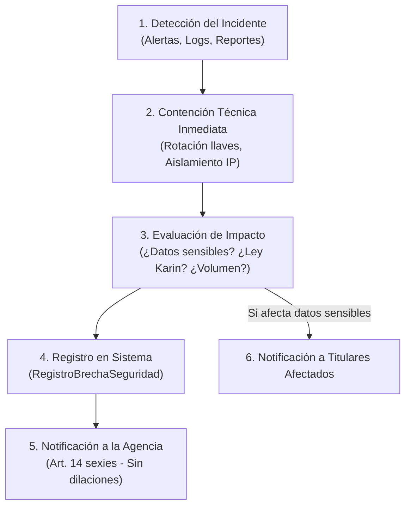

# Procedimiento Operativo Estándar (SOP-SEC-01)
## Gestión y Notificación de Brechas de Seguridad de Datos Personales
**Referencia Normativa:** Ley N° 21.719, Artículo 14 sexies  
**Entidad Responsable:** HD Prevención SpA  
**Fecha de Emisión:** Noviembre 2026  
**Versión:** 1.0  

---

### 1. Objetivo y Alcance
Establecer el protocolo formal para la detección, contención, evaluación, registro y notificación oportuna de incidentes de seguridad que afecten la confidencialidad, integridad o disponibilidad de datos personales tratados en la plataforma HD Prevención, dando cumplimiento estricto a las obligaciones del Artículo 14 sexies de la Ley N° 21.719.

---

### 2. Definición de Brecha de Seguridad
Cualquier incidente que ocasione de forma accidental o ilícita la destrucción, pérdida, alteración, divulgación no autorizada de datos personales transmitidos, conservados o tratados de otra forma, o el acceso no autorizado a dichos datos.

---

### 3. Matriz de Clasificación de Severidad

| Nivel de Severidad | Criterio de Calificación | Plazo de Contención | Obligación Notificación Agencia | Notificación Titulares |
| :--- | :--- | :--- | :--- | :--- |
| **Baja** | No compromete datos sensibles ni causa daño probable a los titulares (ej. falla temporal sin fuga) | < 12 horas | Registro interno obligatorio | No requerida |
| **Media** | Compromete datos identificatorios básicos de menos de 100 personas, sin datos sensibles | < 6 horas | Notificación sin dilaciones indebidas | Evaluada según riesgo |
| **Alta** | Compromete relatos o expedientes de Ley Karin, diagnósticos médicos de accidentes o licencias médicas | < 2 horas | **Obligatoria e Inmediata** | **Obligatoria** |
| **Crítica** | Compromete a gran escala la base de datos o involucra credenciales de acceso maestro | Inmediata | **Obligatoria e Inmediata** | **Obligatoria y Masiva** |

---

### 4. Flujo Operativo de Respuesta



#### Paso 1: Detección y Notificación Interna (Horas 0 a 2)
Cualquier miembro del equipo de desarrollo, soporte o infraestructura que detecte indicios de acceso anómalo debe activar el canal de alerta de seguridad `seguridad@hdprevencion.cl`.

#### Paso 2: Contención Técnica Inmediata (Horas 2 a 6)
- Revocación de sesiones activas (`JWT Blacklist`).
- Bloqueo de IPs origen en firewall/CDN.
- Rotación de `SECRET_KEY` y claves de base de datos.
- Aislamiento de servidores comprometidos.

#### Paso 3: Registro en Plataforma
Crear la entrada correspondiente en el modelo `RegistroBrechaSeguridad` con:
- Código de incidente (`SEC-YYYY-NNN`).
- Naturaleza del incidente (Confidencialidad, Integridad, Disponibilidad).
- Evaluación de afectación de datos sensibles.

#### Paso 4: Notificación a la Agencia de Protección de Datos Personales
Remitir comunicación oficial a la Agencia incluyendo:
1. Naturaleza del incidente y categorías de datos involucrados.
2. Número estimado de personas afectadas.
3. Medidas correctivas adoptadas de inmediato.
4. Datos de contacto del responsable técnico o DPD.

#### Paso 5: Notificación a los Titulares
Cuando la brecha comprometa datos sensibles (Ley Karin, salud de trabajadores) o menores de 14 años, notificar directamente a sus correos registrados en un lenguaje claro y comprensible, informando las medidas preventivas recomendadas.

---

### 5. Plantilla Oficial de Notificación a la Agencia

```text
A: Agencia de Protección de Datos Personales de Chile
DE: HD Prevención SpA (Responsable / Encargado del Tratamiento)
MATERIA: Notificación Formal de Brecha de Seguridad (Art. 14 sexies Ley N° 21.719)

1. Identificación del Responsable:
   - Razón Social: HD Prevención SpA
   - Correo de Contacto: privacidad@hdprevencion.cl / seguridad@hdprevencion.cl

2. Descripción del Incidente:
   - Código Interno: [SEC-YYYY-NNN]
   - Fecha y hora de detección: [AAAA-MM-DD HH:MM Santiago]
   - Naturaleza: [Pérdida de confidencialidad / acceso no autorizado]

3. Datos y Titulares Afectados:
   - Categorías de datos: [Identificatorios / Salud laboral / Laborales]
   - Número aproximado de titulares: [Cantidad]
   - Datos sensibles involucrados: [Sí / No - Especificar]

4. Posibles Consecuencias:
   - [Detallar riesgos identificados para los titulares]

5. Medidas Adoptadas:
   - [Medidas inmediatas de mitigación y contención implementadas]
   - [Medidas para prevenir su reiteración]

6. Notificación a Titulares:
   - [Se ha procedido / Se procederá a comunicar a los afectados]
```
