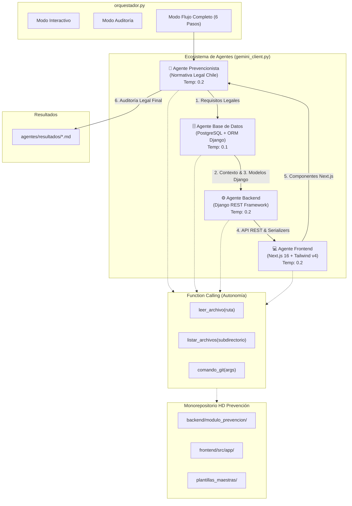

# 🤖 Sistema de Agentes Especializados con IA — HD Prevención

Ecosistema multi-agente autónomo basado en el SDK oficial **Google Gemini (`google-genai`)** utilizando el modelo de última generación **`gemini-3.8-flash`**.

Este subsistema permite acelerar el desarrollo del SaaS **HD Prevención**, garantizando que cada modelo de datos, endpoint de API e interfaz de usuario cumpla estrictamente con la **normativa chilena de seguridad y salud en el trabajo** y los estándares de ingeniería de software del proyecto.

---

## 📑 Tabla de Contenidos

1. [Arquitectura General](#-arquitectura-general)
2. [Los 4 Agentes Especializados](#-los-4-agentes-especializados)
   - [1. Agente Prevencionista de Riesgos (Normativa Chile)](#1-agente-prevencionista-de-riesgos-normativa-chile)
   - [2. Agente Experto en Base de Datos y Procesamiento](#2-agente-experto-en-base-de-datos-y-procesamiento)
   - [3. Agente Backend Developer](#3-agente-backend-developer)
   - [4. Agente Frontend Developer](#4-agente-frontend-developer)
3. [Herramientas Autónomas (Function Calling)](#-herramientas-autónomas-function-calling)
4. [Configuración Técnica de Gemini](#-configuración-técnica-de-gemini)
5. [Requisitos Previos e Instalación](#-requisitos-previos-e-instalación)
6. [Instrucciones de Ejecución](#-instrucciones-de-ejecución)
   - [Modo 1: Interactivo (Chat con Agentes)](#modo-1-interactivo-chat-con-agentes)
   - [Modo 2: Auditoría Legal Puntual](#modo-2-auditoría-legal-puntual)
   - [Modo 3: Flujo Completo / Pipeline de 6 Pasos](#modo-3-flujo-completo--pipeline-de-6-pasos)
   - [Script de Prueba Rápida (`test_prevencionista.py`)](#script-de-prueba-rápida-test_prevencionistapy)
   - [Importación Programática en Python](#importación-programática-en-python)
7. [Persistencia de Resultados (`agentes/resultados/`)](#-persistencia-de-resultados-agentesresultados)
8. [Estructura del Directorio](#-estructura-del-directorio)
9. [Solución de Problemas Frecuentes](#-solución-de-problemas-frecuentes)

---

## 🏛️ Arquitectura General

El sistema opera bajo un enfoque de **roles especializados y complementarios**. En lugar de depender de un prompt genérico, cada agente cuenta con un rol delimitado, reglas no negociables de su stack técnico y acceso a herramientas nativas para leer e inspeccionar el repositorio real.



---

## 👥 Los 4 Agentes Especializados

| Agente | Archivo | Rol / Identidad | Temperatura | Ámbito de Acción |
| :--- | :--- | :--- | :---: | :--- |
| **Prevencionista** | `agenteexpertoprevencionista.py` | Ingeniero Senior SST (Chile) | `0.2` | Cumplimiento legal, jerarquía de control, DIAT/DIEP, DS 594, DS 40, CPHS, protocolos MINSAL. |
| **Base de Datos** | `agentebd.py` | Database & Data Processing Expert | `0.1` | PostgreSQL, ORM Django, migraciones, índices, transacciones y procesador de planillas IPER (`openpyxl`). |
| **Backend** | `agentebackend.py` | Backend Engineer (Django/DRF) | `0.2` | Endpoints REST, autenticación JWT, capa `services.py`, permisos y sanitización en `backend/`. |
| **Frontend** | `agentefrontend.py` | Frontend Engineer (Next.js/React) | `0.2` | Interfaz web Next.js 16, App Router, React 19, TypeScript estricto, Tailwind v4 y cookies HttpOnly. |

---

### 1. Agente Prevencionista de Riesgos (Normativa Chile)

- **Archivo**: [`agenteexpertoprevencionista.py`](file:///c:/Users/Ignacio/Documents/Proyectos/Proyecto-hdprevencion/agentes/agenteexpertoprevencionista.py)
- **Instancia**: `agente_prevencionista`
- **Misión**: Auditar y velar por que el software cumpla al 100% con la legislación chilena de prevención de riesgos laborales. No juzga sintaxis de código, sino la **lógica de negocio**.
- **Marco Legal que audita**:
  - **Ley 16.744**: Seguro social contra riesgos de accidentes del trabajo y enfermedades profesionales. Distinción obligatoria entre *Accidente del Trabajo*, *Accidente de Trayecto* y *Enfermedad Profesional*. Formatos DIAT y DIEP.
  - **Decreto Supremo N° 594**: Condiciones sanitarias y ambientales básicas en los lugares de trabajo.
  - **Decreto Supremo N° 40**: Obligación de Informar los Riesgos Laborales (ODI / DAS) y reglamentos internos.
  - **Decreto Supremo N° 54**: Constitución y funcionamiento de Comités Paritarios de Higiene y Seguridad (CPHS).
  - **Decreto Supremo N° 76**: Gestión de seguridad y salud en faenas con régimen de subcontratación (Art. 66 bis Ley 16.744).
  - **Protocolos MINSAL**: TMERT (trastornos musculoesqueléticos), PREXOR (ruido ocupacional), Radiación UV, PLANESI (sílice), Plaguicidas, SUSESO-ISTAS 21 (riesgos psicosociales).
  - **Jerarquía de Control de Riesgos**: Obliga a que toda Matriz IPER siga el orden: *Eliminación → Sustitución → Controles de Ingeniería → Controles Administrativos → EPP*.
- **Estructura de sus Informes**:
  - 🔴 **Hallazgos Críticos Legales**: Infracciones a la ley o datos mandatorios faltantes.
  - 🟡 **Recomendaciones de Mejora**: Oportunidades operativas para facilitar el trabajo del prevencionista.
  - 🟢 **Aprobación / Visto Bueno**: Aspectos correctamente modelados.

---

### 2. Agente Experto en Base de Datos y Procesamiento

- **Archivo**: [`agentebd.py`](file:///c:/Users/Ignacio/Documents/Proyectos/Proyecto-hdprevencion/agentes/agentebd.py)
- **Instancia**: `agente_db`
- **Misión**: Garantizar la consistencia, rendimiento y transaccionalidad de la capa de datos de HD Prevención.
- **Reglas Técnicas Principales**:
  - **PostgreSQL + Django ORM 4.2 LTS**: Prohibido el SQL crudo salvo optimizaciones extremas justificadas.
  - **Precisión Numérica**: Usa `DecimalField` para scores y cálculos de nivel de riesgo (nunca `FloatField`).
  - **Estandarización**: Nombra todas las tablas con el prefijo `hdp_` (`Meta.db_table = "hdp_<entidad>"`).
  - **Trazabilidad**: Todo modelo debe incluir `created_at` y `updated_at`.
  - **Rendimiento**: Define `Meta.indexes` en claves foráneas y filtros frecuentes; utiliza `annotate()` y `aggregate()` en la base de datos para evitar loops costosos en Python.
  - **Procesador de Matrices IPER (`openpyxl`)**: Diseña el procesador `IPERProcessor` para validar esquemas Excel, parsear filas en dataclasses, manejar celdas vacías y persistir masivamente mediante `bulk_create()` dentro de transacciones atómicas (`transaction.atomic()`).

---

### 3. Agente Backend Developer

- **Archivo**: [`agentebackend.py`](file:///c:/Users/Ignacio/Documents/Proyectos/Proyecto-hdprevencion/agentes/agentebackend.py)
- **Instancia**: `agente_backend`
- **Misión**: Diseñar APIs REST seguras, escalables y mantenibles en Django REST Framework.
- **Reglas Técnicas Principales**:
  - **Python 3.12**: Type hints nativos (`list[str]`, `dict[str, Any]`), dataclasses y f-strings.
  - **Separación de Responsabilidades**:
    - `models.py`: Entidades y relaciones de dominio.
    - `serializers.py`: Validación y serialización pura de datos.
    - `services.py`: Capa de lógica de negocio (aislada de vistas HTTP).
    - `views.py` / `viewsets.py`: Coordinación de peticiones HTTP.
    - `permissions.py`: Reglas de autorización específicas del SaaS.
  - **Seguridad**: `IsAuthenticated` como permiso por defecto; autenticación JWT vía `djangorestframework_simplejwt` (Access token: 15 min, Refresh token: 7 días).
  - **Respuestas Normalizadas**: Formato de error estándar `{"error": {"code": "...", "message": "...", "details": {}}}` con códigos de estado HTTP semánticos (`201`, `400`, `403`, `404`, `422`).
  - **Prevención N+1**: Uso riguroso de `select_related` y `prefetch_related`.

---

### 4. Agente Frontend Developer

- **Archivo**: [`agentefrontend.py`](file:///c:/Users/Ignacio/Documents/Proyectos/Proyecto-hdprevencion/agentes/agentefrontend.py)
- **Instancia**: `agente_frontend`
- **Misión**: Crear interfaces de usuario modernas, de alta confianza y óptimo rendimiento para prevencionistas de riesgos.
- **Reglas Técnicas Principales**:
  - **Next.js 16 (App Router)**: Estrictamente App Router (`src/app/`), prohibido Pages Router.
  - **React 19**: Server Components por defecto. Directiva `"use client"` exclusivamente cuando se requieran hooks de interactividad (`useState`, `useEffect`, event listeners).
  - **TypeScript 5.x**: Tipado estricto (`"strict": true`). Sin tipos `any` implícitos; interfaces tipadas que reflejen los serializers de Django.
  - **Tailwind CSS v4**: Integración mediante `@tailwindcss/postcss` con sintaxis v4 (`@import "tailwindcss"`).
  - **Seguridad de Sesión**: Tokens JWT gestionados en cookies `HttpOnly` mediante Route Handlers con interceptores automáticos de renovación de token ante respuestas `401`.
  - **Manejo de Errores y Estados**: Feedback visual (banners, toasts), boundaries `error.tsx` y skeletons con `loading.tsx` y `Suspense`.

---

## 🛠️ Herramientas Autónomas (Function Calling)

Todos los agentes heredan de la clase base [`AgenteExperto`](file:///c:/Users/Ignacio/Documents/Proyectos/Proyecto-hdprevencion/agentes/gemini_client.py#L151) en `gemini_client.py`. A través del sistema nativo de herramientas de Gemini, los agentes pueden interactuar con el monorepositorio en tiempo real:

1. **`leer_archivo(ruta_relativa: str) -> str`**:
   - Lee el contenido completo de cualquier archivo del proyecto en UTF-8.
   - Resuelve la ruta relativa respecto a la raíz del monorepositorio.
   - *Ejemplo de uso por el agente*: `leer_archivo("backend/modulo_prevencion/models.py")`.

2. **`listar_archivos(subdirectorio: str = "") -> str`**:
   - Inspecciona recursivamente la estructura de carpetas y archivos.
   - Omite de forma automática carpetas irrelevantes o pesadas: `node_modules`, `.next`, `__pycache__`, `.git`, `venv`, `.venv`, `migrations`, `dist`, `build`.
   - *Ejemplo de uso por el agente*: `listar_archivos("backend/modulo_prevencion")`.

3. **`comando_git(args: str) -> str`**:
   - Ejecuta comandos Git de solo lectura con un límite de tiempo de 15 segundos.
   - Subcomandos autorizados por seguridad: `status`, `log`, `diff`, `branch`, `show`, `shortlog`.
   - *Ejemplo de uso por el agente*: `comando_git("status")` o `comando_git("log --oneline -5")`.

---

## ⚙️ Configuración Técnica de Gemini

La configuración central se encuentra en [`gemini_client.py`](file:///c:/Users/Ignacio/Documents/Proyectos/Proyecto-hdprevencion/agentes/gemini_client.py):

```python
MODELO_GEMINI = "gemini-3.8-flash"

self.config = types.GenerateContentConfig(
    system_instruction=system_prompt,
    temperature=temperatura,       # 0.1 para DB, 0.2 para Prevencionista/Backend/Frontend
    max_output_tokens=8192,        # Respuestas completas de código (~8000 palabras)
    top_p=0.95,                    # Coherencia y fluidez lógica
    top_k=40,                      # Reducción de alucinaciones
    tools=HERRAMIENTAS_AGENTE      # [leer_archivo, listar_archivos, comando_git]
)
```

- **Variables de Entorno**: La clave de acceso se carga automáticamente desde `.env` en la raíz del proyecto bajo la variable:
  ```env
  GEMINI_API_KEY=tu_api_key_aqui
  ```

---

## 📦 Requisitos Previos e Instalación

### 1. Variables de Entorno
Verifica que el archivo `.env` en la raíz del proyecto contenga tu clave de Gemini:
```env
GEMINI_API_KEY=AIzaSy...
```

### 2. Entorno Virtual de Python
Puedes usar el entorno virtual de la raíz (`.venv`) o el del backend (`backend/venv`). Ambos cuentan con las librerías necesarias instaladas.

Si requieres instalarlas manualmente en un entorno nuevo:
```bash
# En Windows (PowerShell)
python -m venv .venv
.\.venv\Scripts\Activate.ps1
pip install -r agentes/requirements.txt
```

Las dependencias clave son:
- `google-genai>=2.23.0`
- `python-dotenv>=1.2.3`

---

## 🚀 Instrucciones de Ejecución

El punto de entrada principal es el script [`orquestador.py`](file:///c:/Users/Ignacio/Documents/Proyectos/Proyecto-hdprevencion/agentes/orquestador.py).

### Modo 1: Interactivo (Chat con Agentes)
Permite conversar directamente con cualquiera de los 4 agentes en una sesión continua de consola:

```powershell
# Desde la raíz del proyecto:
python agentes/orquestador.py --modo interactivo
```

**Flujo en consola:**
```text
======================================================================
ORQUESTADOR HD PREVENCION - Modo Interactivo
======================================================================
Agentes disponibles:
  - prevencionista (Prevencionista de Riesgos (Normativa Chile))
  - backend (Backend Developer)
  - db (Database & Data Processing Expert)
  - frontend (Frontend Developer)

Con que agente quieres trabajar? prevencionista

Conectado con: Prevencionista de Riesgos (Normativa Chile)
Escribe 'salir' para terminar.

Tu: ¿Qué campos son obligatorios por ley para el registro de una DIAT?
```

---

### Modo 2: Auditoría Legal Puntual
Solicita al **Agente Prevencionista** auditar un archivo o carpeta específica del proyecto. El agente usará sus herramientas autónomas para leer el archivo y emitirá su informe legal categorizado:

```powershell
# Auditar los modelos actuales del backend:
python agentes/orquestador.py --modo auditoria --archivo backend/modulo_prevencion/models.py

# Auditar los serializers:
python agentes/orquestador.py --modo auditoria --archivo backend/modulo_prevencion/serializers.py

# Auditar una vista del frontend:
python agentes/orquestador.py --modo auditoria --archivo frontend/src/app/page.tsx
```

> **Nota**: El resultado se imprime en pantalla y se guarda automáticamente como un documento Markdown en `agentes/resultados/`.

---

### Modo 3: Flujo Completo / Pipeline de 6 Pasos
Este es el modo más potente. Orquesta la colaboración secuencial de los agentes para diseñar un módulo completo de principio a fin:

```powershell
# Ejemplo: Construir el módulo de Investigación de Accidentes
python agentes/orquestador.py --modo flujo --modulo "Investigacion de Accidentes"

# Ejemplo: Construir el módulo de Comité Paritario (CPHS)
python agentes/orquestador.py --modo flujo --modulo "Comite Paritario CPHS"

# Ejemplo: Construir el módulo de Matriz IPER
python agentes/orquestador.py --modo flujo --modulo "Matriz IPER"
```

#### Los 6 Pasos del Pipeline:
1. **Paso 1/6 (Prevencionista)**: Define los requisitos legales chilenos, decretos aplicables, campos mandatorios y alertas obligatorias.
2. **Paso 2/6 (Base de Datos)**: Lee el código real existente (`backend/modulo_prevencion/models.py`) para evitar duplicaciones y entender las relaciones disponibles.
3. **Paso 3/6 (Base de Datos)**: Diseña los nuevos modelos Django ORM con tipos de datos correctos, tablas `hdp_` e índices.
4. **Paso 4/6 (Backend)**: Genera serializers DRF, ViewSets con permisos y lógica de negocio en `services.py`.
5. **Paso 5/6 (Frontend)**: Genera los componentes Next.js 16 con App Router, TypeScript estricto y Tailwind v4.
6. **Paso 6/6 (Prevencionista)**: Audita todo el código generado contra los requisitos legales del Paso 1 y emite el informe de conformidad.

---

### Script de Prueba Rápida (`test_prevencionista.py`)
Si deseas ejecutar una prueba directa de auditoría sin ingresar parámetros:

```powershell
python agentes/test_prevencionista.py
```
Este script audita por defecto `backend/modulo_prevencion/models.py` validando la Ley 16.744, DIAT/DIEP y la jerarquía de control de riesgos del DS 40.

---

### Importación Programática en Python
Los agentes están empaquetados y pueden ser importados en cualquier script de Python, tarea en segundo plano o servicio de Django:

```python
from agentes import (
    agente_prevencionista,
    agente_backend,
    agente_db,
    agente_frontend
)

# Ejemplo de uso:
respuesta = agente_prevencionista.enviar_mensaje(
    "¿Qué obligaciones exige el DS 54 para empresas con más de 25 trabajadores?"
)
print(respuesta)
```

---

## 💾 Persistencia de Resultados (`agentes/resultados/`)

Cada ejecución de auditoría o de flujo completo genera automáticamente artefactos en formato Markdown en el directorio [`agentes/resultados/`](file:///c:/Users/Ignacio/Documents/Proyectos/Proyecto-hdprevencion/agentes/resultados):

- Formato de nombre: `<nombre_modulo>_<paso>_<YYYYMMDD_HHMM>.md`
- Ejemplos de archivos generados:
  - `matriz_iper_1_requisitos_legales_20261011_0430.md`
  - `matriz_iper_2_contexto_actual_20261011_0431.md`
  - `matriz_iper_3_modelos_django_20261011_0432.md`
  - `matriz_iper_4_api_drf_20261011_0433.md`
  - `matriz_iper_5_frontend_nextjs_20261011_0434.md`
  - `matriz_iper_6_auditoria_legal_20261011_0435.md`
  - `backend_modulo_prevencion_models.py_auditoria_20261011_0440.md`

Estos archivos sirven como documentación viva y especificación técnica validada para el equipo de desarrollo.

---

## 📁 Estructura del Directorio

```text
agentes/
├── __init__.py                       # Exporta los 4 agentes listos para importar
├── gemini_client.py                  # Cliente base AgenteExperto + Function Calling
├── agenteexpertoprevencionista.py    # Agente Experto en Normativa Chilena
├── agentebd.py                       # Agente de Base de Datos y Datos
├── agentebackend.py                  # Agente de Backend (Django / DRF)
├── agentefrontend.py                 # Agente de Frontend (Next.js / React)
├── orquestador.py                    # CLI principal (Interactivo, Auditoría, Flujo)
├── test_prevencionista.py            # Test directo de auditoría
├── requirements.txt                  # Dependencias del paquete de agentes
├── README.md                         # Documentación completa del subsistema
└── resultados/                       # Directorio de persistencia de artefactos (.md)
    └── .gitkeep
```

---

## ❓ Solución de Problemas Frecuentes

### 1. `ValueError: ¡No se encontró GEMINI_API_KEY en el archivo .env!`
- **Causa**: Falta la variable `GEMINI_API_KEY` o el archivo `.env` no está en la raíz del proyecto.
- **Solución**: Abre el archivo `.env` en la raíz del proyecto y agrega `GEMINI_API_KEY=tu_clave_real`.

### 2. `ModuleNotFoundError: No module named 'google'`
- **Causa**: El entorno virtual de Python no tiene instalado el paquete oficial `google-genai`.
- **Solución**:
  ```powershell
  pip install google-genai python-dotenv
  ```

### 3. Error en Git al usar `comando_git`
- **Causa**: La herramienta solo permite comandos seguros de lectura (`status`, `log`, `diff`, `branch`, `show`, `shortlog`). Comandos como `git commit` o `git push` son rechazados intencionalmente por diseño de seguridad.

### 4. Codificación de caracteres en Windows (PowerShell)
- Si observas caracteres extraños al imprimir emojis en la consola de Windows, ejecuta en PowerShell antes de iniciar el orquestador:
  ```powershell
  [Console]::OutputEncoding = [System.Text.Encoding]::UTF8
  ```
